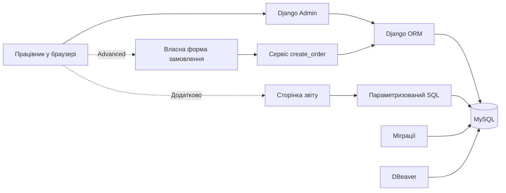
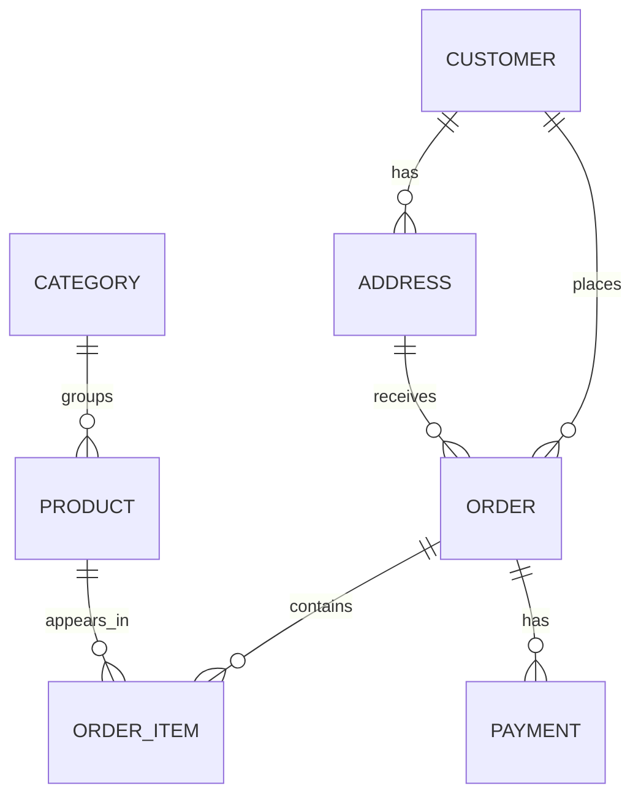

# Курсовий проєкт: інтернет-магазин на Django та MySQL

Побудуємо стандартну адміністративну панель працівника магазину: каталог товарів, клієнтів, адреси, замовлення та платежі. Навчимося переходити від схеми бази даних до робочого застосунку, а потім перевіряти його через браузер і SQL.

Готовий застосунок розміщено в [`app_django`](app_django/), короткий запуск — у [`app_django/README.md`](app_django/README.md). Предметна область та основні сценарії відповідають [прикладу на AdonisJS](instructions_nodejs.md), тому результати можна порівнювати.

Це практичне доповнення до [методичних вказівок курсового проєкту](cp_book.pdf), а не шаблон пояснювальної записки. Вимоги до оформлення узгодьте з керівником. Вітрина покупця, банківська оплата та інтеграція доставки до прикладу не входять.

## Рівні складності

**Базовий рівень — достатній результат роботи:** моделі в окремих файлах, MySQL, міграції, навчальні дані та стандартна Django Admin. Замовлення створюємо через `ModelAdmin`, а його позиції — через `TabularInline` на тій самій сторінці. Власні сервіси, HTML-сторінки, форми та view писати не потрібно.

**Advanced level — за бажанням:** окремий сервіс оформлення замовлення з транзакцією, перевіркою правил і автоматичною фіксацією ціни; власна вебформа як інтерфейс до цього сервісу. SQL-звіт на окремій сторінці також є додатковим розширенням.

Для базового рівня послідовно виконайте розділи **1–10**: після створення адмінпанелі одразу запустіть проєкт і попрацюйте з нею. Потім перейдіть до перевірки та здачі в розділах **13–16**. Розділ **11** містить завдання Advanced level, розділ **12** — додаткову практику ORM і вебзвіту. Їх можна пропустити, не втрачаючи можливості запустити адмінпанель.

## 1. Що саме ми створюємо

### 1.1. Фреймворк: готова основа застосунку

**Фреймворк** — основа для розробки застосунку, яка задає його структуру та надає готові механізми для типових задач. Вебфреймворк допомагає приймати запити браузера, знаходити потрібний обробник, перевіряти введені дані й повертати сторінку. Розробник описує свою предметну область: які є товари, клієнти та замовлення і як із ними працювати.

**Python** — мова, якою ми пишемо код. **Django** — вебфреймворк, написаний на Python. Він уже містить ORM, систему міграцій, форми, шаблони, авторизацію та адміністративну панель. Тому для базового магазину не потрібно окремо створювати сторінку входу та HTML-форму для кожної таблиці.

Наприклад, для каталогу ми описуємо поля моделі `Product` і реєструємо її в Admin. Django надає стандартні сторінки списку, додавання та редагування товарів. Такий шлях від моделі до інтерфейсу показано в [огляді Django](https://docs.djangoproject.com/en/5.2/intro/overview/).

### 1.2. СУБД, ORM і драйвер: хто за що відповідає

**СУБД** — система керування базами даних. У нас це **MySQL**: вона зберігає таблиці, виконує SQL, перевіряє обмеження та забезпечує транзакції. Дані не зберігаються у файлі Python-моделі.

**ORM (Object–Relational Mapping)** — об’єктно-реляційне відображення та інструмент, який пов’язує об’єкти програми з таблицями бази. Django ORM перетворює операції з моделями на SQL, а результати читання — на Python-об’єкти. На відміну від окремого пакета Lucid у прикладі Node.js, ORM уже входить до складу Django.

Наприклад, після створення таблиць можна виконати в Django shell:

```python
from store.models import Product

product = Product.objects.get(pk=1)
print(product.name)
```

`Product` — модель товару, `objects` надає методи роботи з її записами, `get()` шукає один запис, а `pk` означає первинний ключ. Якщо товар із таким ключем існує, отримаємо об’єкт і зможемо прочитати його назву через `product.name`. Якщо запису немає, Django підніме виняток `Product.DoesNotExist`. Це приклад синтаксису: після наповнення використовуйте фактичний ключ товару.

**Драйвер БД** — пакет, який забезпечує з’єднання Python із конкретною СУБД. Тут це `mysqlclient`. Ланцюжок такий: код викликає ORM → Django через драйвер надсилає SQL → MySQL виконує запит → результат повертається в код.

ORM скорочує повторюваний код, але не замінює знання SQL. Розробник усе одно має розуміти ключі, зв’язки, JOIN, індекси й транзакції. Для перевірки запитів та структури таблиць ми працюватимемо з MySQL також напряму через DBeaver.

### 1.3. CRUD і стандартна адміністративна панель

**CRUD** — чотири основні операції над даними:

| Операція | Значення | Приклад у магазині | Типовий SQL |
|---|---|---|---|
| Create | Створити | Додати товар | `INSERT` |
| Read | Прочитати | Відкрити список товарів | `SELECT` |
| Update | Змінити | Виправити назву товару | `UPDATE` |
| Delete | Видалити | Прибрати невикористану категорію | `DELETE` |

**Django Admin** — готова внутрішня панель зі списками й формами. Вона підходить для працівника магазину. У базовому завданні використаємо стандартну форму замовлення з вкладеними позиціями. Окрему форму та сервіс розглянемо лише в Advanced level. Таке використання панелі відповідає [призначенню Django Admin](https://docs.djangoproject.com/en/5.2/ref/contrib/admin/).

Наприклад, працівник заповнює форму товару й натискає «Зберегти». Браузер надсилає HTTP-запит, Django перевіряє форму, ORM формує операцію запису, а MySQL перевіряє обмеження і зберігає дані. Якщо SKU вже зайнятий, користувач має отримати помилку замість другого товару з тим самим артикулом.

**HTTP-запит** — звернення браузера до сервера, а **HTTP-відповідь** — результат обробки: наприклад, HTML-сторінка або перенаправлення. Для читання сторінки зазвичай використовується метод GET, для надсилання форми — POST. У базовому завданні ці обробники вже надає Django Admin.

Як проходить запит у базовому варіанті та розширеннях:



| Інструмент | Роль у прикладі |
|---|---|
| Python 3.12 | Виконує код застосунку |
| Django 5.2 | ORM, міграції, форми, маршрути, шаблони та адмінпанель |
| MySQL 8.4, InnoDB | Дані, зовнішні ключі, обмеження, транзакції |
| mysqlclient | Драйвер: з’єднує Python із MySQL |
| python-dotenv | Читає локальні налаштування з `.env` |
| DBeaver | Дозволяє переглядати таблиці та виконувати SQL вручну |

**Пакет** — готовий набір Python-модулів, який можна встановити й використати у проєкті. **Залежність** — пакет, потрібний нашому застосунку; наприклад, Django або mysqlclient. Залежності зафіксовані у `requirements.txt`. Використовуйте цей файл, щоб усі студенти працювали з однаковими версіями. `requirements.in` описує допустимі гілки для контрольованого оновлення залежностей викладачем.

## 2. Підготовка та два способи проходження

Потрібні Python 3.12, MySQL 8.4, DBeaver і редактор. Достатньо розуміти змінні, функції, класи, списки, імпорти та винятки Python. Встановлення MySQL і DBeaver розглянуто в [основному практикумі](../README.md).

**CLI (Command-Line Interface)** — інтерфейс командного рядка. Команди нижче вводять у терміналі. `cd` змінює поточну папку, а шляхи до файлів відраховуються від неї. Команда `python manage.py ...` запускає службову дію Django для нашого проєкту: наприклад, створення користувача або застосування міграцій.

У терміналі перевірте:

```bash
python3 --version
mysql --version
```

У Windows використовуйте `py -3.12` замість `python3`. Якщо `mysql` не знайдено, SQL-команди можна виконати в DBeaver.

**Спосіб А — запустити готовий приклад.** Із кореня репозиторію перейдіть до застосунку:

```bash
cd course_project/app_django
python3 -m venv .venv
```

**Спосіб Б — зібрати приклад самостійно.** Створіть поруч нову папку `store_django`, щоб зберегти готовий код як зразок:

```bash
cd course_project
mkdir store_django
cd store_django
python3 -m venv .venv
```

Для способу Б скопіюйте `requirements.txt` із `../app_django/`. Далі в обох способах працюйте з поточної папки застосунку: усі шляхи `config/...`, `store/...` та команди `python manage.py ...` задані відносно неї.

**Віртуальне середовище** `.venv` зберігає пакети саме цього проєкту. Його не додають у Git. Активуйте його:

macOS / Linux:

```bash
source .venv/bin/activate
```

Windows PowerShell:

```powershell
.venv\Scripts\Activate.ps1
```

Якщо PowerShell не дозволяє активацію, замість зміни системної політики можна викликати `.venv\Scripts\python.exe` у кожній наступній команді замість `python`.

Встановіть пакети:

```bash
python -m pip install -r requirements.txt
python -m django --version
```

`pip` — менеджер пакетів. Запис `python -m pip` запускає його саме для обраного Python. Очікується Django `5.2.x`.

Для `mysqlclient` іноді потрібні системні бібліотеки. На macOS за наявності Homebrew: `brew install mysql-client pkg-config`, потім `export PKG_CONFIG_PATH="$(brew --prefix mysql-client)/lib/pkgconfig"`. На Ubuntu/Debian: `sudo apt install python3-dev default-libmysqlclient-dev build-essential pkg-config`. Для Windows використовуйте 64-бітний Python 3.12 і доступний для нього wheel. Деталі — в [офіційній інструкції mysqlclient](https://github.com/PyMySQL/mysqlclient#install). Не встановлюйте випадковий інший драйвер лише для приховування помилки.

## 3. Проєкт, застосунок і порядок файлів

Цей крок потрібен **лише для способу Б**:

```bash
python -m django startproject config .
python manage.py startapp store
```

**Проєкт** `config` містить загальні налаштування сайту. **Django-застосунок** `store` — окрема функціональна частина, у нас це магазин. `manage.py` — точка входу для службових команд.

Django створить `store/models.py`, `store/admin.py`, `store/views.py` і `store/tests.py`. У нашому прикладі їх замінюють однойменні пакети — папки з `__init__.py`. У свіжому навчальному проєкті видаліть ці чотири порожні згенеровані файли через редактор і створіть папки. Не залишайте одночасно `models.py` та `models/`.

```text
app_django/
├── manage.py
├── requirements.txt
├── .env.example
├── .gitignore
├── config/
│   ├── settings.py
│   ├── urls.py
│   └── wsgi.py
└── store/
    ├── apps.py
    ├── urls.py
    ├── models/             # Одна модель — один файл
    │   ├── __init__.py
    │   ├── category.py
    │   ├── customer.py
    │   ├── address.py
    │   ├── product.py
    │   ├── order.py
    │   ├── order_item.py
    │   └── payment.py
    ├── admin/              # Налаштування адмінпанелі для кожної моделі
    ├── forms/              # Advanced: власні форми
    ├── services/           # Advanced: сервіс замовлень
    ├── queries/            # Додатково: SQL-звіт
    ├── views/              # Advanced: власні обробники запитів
    ├── templates/          # Advanced: HTML-шаблони
    ├── management/commands/# Команда навчальних даних
    ├── migrations/         # Історія змін схеми
    └── tests/              # Автоматизовані перевірки
```

У кожному Python-пакеті є `__init__.py`, зокрема у `management/` та `management/commands/`. HTML-папкам він не потрібен. Поділ моделей на файли — прийнята тут домовленість для читабельності, а не універсальна вимога Django. Django підтримує таку [організацію моделей у пакеті](https://docs.djangoproject.com/en/5.2/topics/db/models/#organizing-models-in-a-package).

У базовому варіанті не створюйте `forms/`, `services/`, `queries/`, `views/`, `templates/` і `store/urls.py`: їх додамо тільки для розширень. Згенерований `views.py` можна залишити порожнім. Для способу Б поступово створюйте потрібні для обраного рівня файли за посиланнями нижче. Файли з посилань копіюйте повністю; фрагменти в тексті пояснюють ключові ідеї й не завжди є повним вмістом файла.

## 4. Окрема база та налаштування

### 4.1. Створення бази

Виконайте в DBeaver від адміністратора MySQL. Замініть навчальний пароль власним:

```sql
CREATE DATABASE store_django
    CHARACTER SET utf8mb4 COLLATE utf8mb4_unicode_ci;
CREATE USER 'store_django'@'localhost' IDENTIFIED BY 'replace-with-local-password';
GRANT ALL PRIVILEGES ON store_django.* TO 'store_django'@'localhost';
```

`utf8mb4` дозволяє зберігати український текст. Навчальний користувач може створювати таблиці у своїй базі, але не отримує глобальних адміністративних прав. MySQL окремо враховує ім’я користувача та хост. Для контейнера або віддаленого сервера налаштуйте дозволений хост під фактичне підключення.

Не використовуйте базу SQL-практикуму або AdonisJS. У Django є власні міграції та службові таблиці. Не запускайте `sql/01_create_database.sql` поверх цієї схеми.

### 4.2. Файл `.env`

Скопіюйте [`.env.example`](app_django/.env.example) у `.env` поруч із `manage.py`. `.env` — звичайний текстовий файл, а не команда. Його не слід називати `.env.txt`.

Згенеруйте секретний ключ:

```bash
python -c "from django.core.management.utils import get_random_secret_key; print(get_random_secret_key())"
```

Вставте результат у `.env`, бажано в одинарних лапках:

```dotenv
DJANGO_SECRET_KEY='сюди-вставте-згенерований-ключ'
DJANGO_DEBUG=True
DJANGO_ALLOWED_HOSTS=127.0.0.1,localhost
DB_NAME=store_django
DB_USER=store_django
DB_PASSWORD='ваш-пароль-MySQL'
DB_HOST=127.0.0.1
DB_PORT=3306
```

`SECRET_KEY` підписує службові дані Django. Це не пароль адміністратора й не пароль бази. Не генеруйте його заново при кожному запуску. Значення `DEBUG=True` призначене для локального навчання.

Додайте [`.gitignore`](app_django/.gitignore), який виключає `.env`, `.venv` та кеш Python. `.env.example` з назвами змінних залишається у Git. Сам `.env` не шифрується; `.gitignore` не прибирає секрет, який уже було закомічено.

### 4.3. Підключення Django

Для способу Б перенесіть повний [`config/settings.py`](app_django/config/settings.py), [`config/wsgi.py`](app_django/config/wsgi.py) і [`store/apps.py`](app_django/store/apps.py). Налаштування маршрутів перенесемо після створення обробників.

У `INSTALLED_APPS` є `store.apps.StoreConfig`. Без цього Django не включить моделі магазину до проєкту. Основна частина підключення:

```python
DATABASES = {"default": {
    "ENGINE": "django.db.backends.mysql",
    "NAME": os.environ.get("DB_NAME", "store_django"),
    "USER": os.environ.get("DB_USER", "store_django"),
    "PASSWORD": os.environ.get("DB_PASSWORD", ""),
    "HOST": os.environ.get("DB_HOST", "127.0.0.1"),
    "PORT": os.environ.get("DB_PORT", "3306"),
    "OPTIONS": {
        "charset": "utf8mb4",
        "init_command": "SET sql_mode='STRICT_TRANS_TABLES'",
    },
}}
```

Строгий SQL-режим допомагає отримати помилку замість мовчазного обрізання некоректних даних. Для транзакцій таблиці повинні використовувати InnoDB. Обґрунтування налаштувань — у [документації Django для MySQL](https://docs.djangoproject.com/en/5.2/ref/databases/#mysql-notes).

У налаштуваннях також увімкнені сесії, авторизація, CSRF-захист і шаблони. `LANGUAGE_CODE="uk"` обирає українську мову, а `TIME_ZONE="Europe/Kyiv"` — часовий пояс відображення. Після зміни `.env` перезапустіть сервер.

## 5. Проєктування предметної області

До написання моделей опишіть, хто користується системою і що він робить. У прикладі працівник підтримує каталог, реєструє клієнта, створює замовлення та переглядає його суму.

| Сутність / таблиця | Основні поля | Призначення |
|---|---|---|
| Category / `categories` | `id`, `name` UNIQUE | Категорії товарів |
| Customer / `customers` | `id`, `full_name`, `email` UNIQUE, `created_at` | Покупці |
| Address / `addresses` | `id`, `customer_id`, `city`, `street`, `postal_code` | Адреси клієнтів |
| Product / `products` | `id`, `category_id`, `sku` UNIQUE, `name`, `price`, `stock_quantity`, `is_active` | Каталог |
| Order / `orders` | `id`, `customer_id`, `shipping_address_id`, `status`, `created_at` | Замовлення |
| OrderItem / `order_items` | `id`, `order_id`, `product_id`, `quantity`, `unit_price` | Товари в замовленні |
| Payment / `payments` | `id`, `order_id`, `amount`, `status`, `created_at` | Облік платежів |

Зв’язки між сутностями:



У базовій панелі допускаємо замовлення-чернетку без позицій. В Advanced level оформлення вимагає принаймні одну позицію; це перевіряє сервіс, а не зовнішній ключ.

### Бізнес-правила і межі гарантій

| Правило | Базовий рівень | Advanced level |
|---|---|---|
| SKU та email унікальні | `unique=True`, MySQL | Так само |
| Ціна та сума платежу додатні | Валідатор та CHECK | Так само |
| Кількість позиції більша нуля | Форма Admin та CHECK | Додатково сервіс |
| Товар не повторюється в замовленні | Inline-форма та UNIQUE | Додатково сервіс |
| Адреса належить клієнту | `Order.clean()` у формі Admin | Додатково сервіс |
| Кількість позицій | Дозволена чернетка без позицій | Сервіс вимагає 1–10 позицій |
| Активність товару | Працівник перевіряє вручну | Сервіс відхиляє неактивні товари |
| Ціна продажу | Працівник вводить `unit_price` вручну | Сервіс бере поточну ціну каталогу |
| Допустимі статуси | `TextChoices` та CHECK | Так само |
| Видалення зв’язаних записів | `PROTECT` | Додатково заборонене видалення замовлень у панелі |

Базова панель дозволяє працівнику виправляти позиції та ціну продажу. Це навчальний CRUD, а не завершена система незмінного обліку продажів. В Advanced level стандартне додавання замінимо сервісом, а позиції зробимо доступними лише для читання.

Для грошей використовуємо `DecimalField`, а в Python — `Decimal`, щоб уникнути похибок `float`. `stock_quantity` у базовому прикладі є інформаційним залишком: оформлення його не списує і не резервує. Це така сама межа базової операції, як у прикладі AdonisJS.

Адреса тут є посиланням на довідник, а не незмінним знімком: редагування її вулиці змінить відображення старих замовлень. Для реального магазину потрібен знімок адреси доставки. Платежі обліковує працівник вручну; вони не змінюють статус замовлення автоматично. Вибір статусу не реалізує повноцінну схему переходів.

### Нормалізація та відмінності від SQL-практикуму

Категорію винесено в окрему таблицю: назва не повторюється в кожному товарі. Позиції замовлення утворюють окрему таблицю для зв’язку багато-до-багатьох між замовленнями й товарами. У її рядку кількість та ціна залежать від конкретної позиції. `unit_price` — історична ціна продажу, тому вона має інший зміст, ніж поточне `Product.price`. Суму замовлення обчислюємо із позицій.

У всіх моделях Django автоматично створює `id` типу `BigAutoField`. Тому замість `product_id` як первинного ключа з SQL-практикуму використовуємо `products.id`. Зовнішнє поле `product` створює колонку `product_id`. Для `order_items` є окремий `id` і унікальна пара `(order_id, product_id)`.

На відміну від прикладу AdonisJS, ми не додаємо складений FK для власника адреси. Це свідоме спрощення: правило належності адреси перевіряє форма Django Admin через `Order.clean()`, а в Advanced level — також сервіс, але прямий SQL або `QuerySet.update()` можуть його обійти. Також порожні назви відхиляє форма, а не окремий SQL CHECK. Не приписуйте базі гарантії, яких у ній немає.

## 6. Моделі: кожна в окремому файлі

**Модель** — Python-клас, який описує дані сутності: поля, зв’язки та обмеження. У цьому прикладі кожній моделі відповідає окрема таблиця, а збереженому об’єкту моделі — рядок цієї таблиці.

| У Python | У нашій базі MySQL |
|---|---|
| Клас `Product` | Таблиця `products` |
| Поле `name` | Колонка `name` |
| Збережений об’єкт `product` | Один рядок товару |
| `product.pk` | Значення первинного ключа `id` |
| Поле `category` типу `ForeignKey` | Колонка `category_id` зі зв’язком на категорію |

**Поле** задає тип і властивості одного атрибута. **Зв’язок** описує, як одна сутність посилається на іншу. Наприклад, товар належить категорії, а категорія може мати багато товарів. **Обмеження цілісності** визначає допустимі дані: ціна додатна, артикул унікальний, категорія існує.

Саме оголошення класу або створення об’єкта `Product(...)` ще не додає рядок у MySQL. Для запису потрібна операція збереження. Так само зміна опису поля в Python не змінює автоматично структуру вже створеної таблиці — для цього потрібні міграції.

Створіть у `store/models/` сім файлів моделей і `__init__.py`. Повний вміст кожного файла наведено нижче:

| Файл | На що звернути увагу |
|---|---|
| [`models/category.py`](app_django/store/models/category.py) | Унікальна назва та `__str__` |
| [`models/customer.py`](app_django/store/models/customer.py) | `EmailField`, дата створення |
| [`models/address.py`](app_django/store/models/address.py) | Зовнішній ключ до клієнта |
| [`models/product.py`](app_django/store/models/product.py) | Ціна, залишок, активність, SQL CHECK |
| [`models/order.py`](app_django/store/models/order.py) | Статуси, власник адреси, індекс дати |
| [`models/order_item.py`](app_django/store/models/order_item.py) | Кількість, ціна продажу, унікальна пара |
| [`models/payment.py`](app_django/store/models/payment.py) | Сума, статус платежу, зв’язок із замовленням |

### 6.1. Категорія — `store/models/category.py`

```python
from django.db import models


class Category(models.Model):
    name = models.CharField("Назва", max_length=100, unique=True)

    class Meta:
        db_table = "categories"
        verbose_name = "категорія"
        verbose_name_plural = "категорії"
        ordering = ["name"]

    def __str__(self):
        return self.name
```

`models.Model` надає класу можливості ORM. `CharField` — короткий текст, `max_length` — його максимальна довжина. `Meta` містить налаштування моделі. `db_table` задає SQL-назву замість стандартної `store_category`. `__str__` визначає зрозумілий підпис у списках вибору.

### 6.2. Клієнт — `store/models/customer.py`

```python
from django.db import models


class Customer(models.Model):
    full_name = models.CharField("ПІБ", max_length=150)
    email = models.EmailField("Email", unique=True)
    created_at = models.DateTimeField("Створено", auto_now_add=True)

    class Meta:
        db_table = "customers"
        verbose_name = "клієнт"
        verbose_name_plural = "клієнти"
        ordering = ["full_name"]

    def __str__(self):
        return self.full_name
```

`EmailField` перевіряє формат email під час валідації, а `unique=True` забороняє повтори. `auto_now_add=True` автоматично записує час створення клієнта.

### 6.3. Адреса — `store/models/address.py`

```python
from django.db import models


class Address(models.Model):
    customer = models.ForeignKey(
        "store.Customer",
        on_delete=models.PROTECT,
        related_name="addresses",
        verbose_name="Клієнт",
    )
    city = models.CharField("Місто", max_length=100)
    street = models.CharField("Вулиця та будинок", max_length=200)
    postal_code = models.CharField("Поштовий індекс", max_length=20)

    class Meta:
        db_table = "addresses"
        verbose_name = "адреса"
        verbose_name_plural = "адреси"

    def __str__(self):
        return f"{self.customer} — {self.city}, {self.street}"
```

Рядок `"store.Customer"` дозволяє послатися на модель без циклічних імпортів. `address.customer` повертає клієнта, `address.customer_id` — його ключ, а `customer.addresses.all()` — адреси клієнта. `PROTECT` забороняє ORM видаляти клієнта, на якого посилаються адреси. Це поведінка Django, а не генерація `ON DELETE PROTECT` у MySQL; SQL-видалення додатково обмежують звичайні FK.

### 6.4. Товар — `store/models/product.py`

```python
from decimal import Decimal

from django.core.validators import MinValueValidator
from django.db import models


class Product(models.Model):
    category = models.ForeignKey(
        "store.Category",
        on_delete=models.PROTECT,
        related_name="products",
        verbose_name="Категорія",
    )
    sku = models.CharField("Артикул", max_length=40, unique=True)
    name = models.CharField("Назва", max_length=200)
    price = models.DecimalField(
        "Ціна, грн",
        max_digits=12,
        decimal_places=2,
        validators=[MinValueValidator(Decimal("0.01"))],
    )
    stock_quantity = models.PositiveIntegerField("Залишок", default=0)
    is_active = models.BooleanField("Активний", default=True)

    class Meta:
        db_table = "products"
        verbose_name = "товар"
        verbose_name_plural = "товари"
        ordering = ["name"]
        constraints = [
            models.CheckConstraint(
                condition=models.Q(price__gt=0), name="product_price_positive"
            ),
        ]

    def __str__(self):
        return f"{self.name} ({self.sku})"
```

Для ціни передбачено до 12 цифр загалом, з яких 2 після крапки. Валідатор допомагає показати людині помилку, а `CheckConstraint` перевіряє додатну ціну на рівні БД. `Q` описує умову, `__gt` означає «більше». `PositiveIntegerField` допускає нуль, тому залишок може бути нульовим. `category.products.all()` повертає товари категорії.

### 6.5. Замовлення — `store/models/order.py`

```python
from django.core.exceptions import ValidationError
from django.db import models


class Order(models.Model):
    class Status(models.TextChoices):
        NEW = "new", "Нове"
        PAID = "paid", "Оплачене"
        SHIPPED = "shipped", "Відправлене"
        COMPLETED = "completed", "Завершене"
        CANCELLED = "cancelled", "Скасоване"

    customer = models.ForeignKey(
        "store.Customer",
        on_delete=models.PROTECT,
        related_name="orders",
        verbose_name="Клієнт",
    )
    shipping_address = models.ForeignKey(
        "store.Address",
        on_delete=models.PROTECT,
        related_name="orders",
        verbose_name="Адреса доставки",
    )
    status = models.CharField(
        "Статус", max_length=20, choices=Status.choices, default=Status.NEW
    )
    created_at = models.DateTimeField("Створено", auto_now_add=True)

    class Meta:
        db_table = "orders"
        verbose_name = "замовлення"
        verbose_name_plural = "замовлення"
        ordering = ["-created_at", "-pk"]
        indexes = [models.Index(fields=["created_at"], name="orders_created_idx")]
        constraints = [
            models.CheckConstraint(
                condition=models.Q(
                    status__in=["new", "paid", "shipped", "completed", "cancelled"]
                ),
                name="order_status_valid",
            )
        ]

    def clean(self):
        super().clean()
        if self.shipping_address_id and self.customer_id:
            from .address import Address

            if not Address.objects.filter(
                pk=self.shipping_address_id, customer_id=self.customer_id
            ).exists():
                raise ValidationError(
                    {"shipping_address": "Адреса не належить цьому клієнту."}
                )

    def __str__(self):
        return f"Замовлення №{self.pk}"
```

`TextChoices` задає значення статусів і підписи для форми; CHECK обмежує статуси також у БД. Метод `clean()` перевіряє, що адреса доставки належить обраному клієнту. Індекс `orders_created_idx` створюється за датою замовлення. Від’ємний знак у `ordering` задає сортування за спаданням.

### 6.6. Позиція замовлення — `store/models/order_item.py`

```python
from decimal import Decimal

from django.core.validators import MinValueValidator
from django.db import models


class OrderItem(models.Model):
    order = models.ForeignKey(
        "store.Order",
        on_delete=models.PROTECT,
        related_name="items",
        verbose_name="Замовлення",
    )
    product = models.ForeignKey(
        "store.Product",
        on_delete=models.PROTECT,
        related_name="order_items",
        verbose_name="Товар",
    )
    quantity = models.PositiveIntegerField(
        "Кількість", validators=[MinValueValidator(1)]
    )
    unit_price = models.DecimalField(
        "Ціна продажу, грн",
        max_digits=12,
        decimal_places=2,
        validators=[MinValueValidator(Decimal("0.01"))],
    )

    class Meta:
        db_table = "order_items"
        verbose_name = "позиція замовлення"
        verbose_name_plural = "позиції замовлень"
        constraints = [
            models.UniqueConstraint(
                fields=["order", "product"], name="order_product_unique"
            ),
            models.CheckConstraint(
                condition=models.Q(quantity__gt=0), name="item_quantity_positive"
            ),
            models.CheckConstraint(
                condition=models.Q(unit_price__gt=0), name="item_price_positive"
            ),
        ]

    def __str__(self):
        return f"{self.product} × {self.quantity}"
```

`UniqueConstraint` не дозволяє двічі додати той самий товар до одного замовлення. Для кількості потрібні і валідатор, і CHECK `quantity > 0`, оскільки `PositiveIntegerField` сам по собі допускає нуль. `unit_price` зберігає ціну продажу окремо від поточної ціни товару; у базовій адмінпанелі її вводить працівник. `order.items.all()` повертає позиції замовлення.

### 6.7. Платіж — `store/models/payment.py`

```python
from decimal import Decimal

from django.core.validators import MinValueValidator
from django.db import models


class Payment(models.Model):
    class Status(models.TextChoices):
        PENDING = "pending", "Очікується"
        SUCCESSFUL = "successful", "Успішний"
        FAILED = "failed", "Невдалий"
        REFUNDED = "refunded", "Повернений"

    order = models.ForeignKey(
        "store.Order",
        on_delete=models.PROTECT,
        related_name="payments",
        verbose_name="Замовлення",
    )
    amount = models.DecimalField(
        "Сума, грн",
        max_digits=12,
        decimal_places=2,
        validators=[MinValueValidator(Decimal("0.01"))],
    )
    status = models.CharField(
        "Статус", max_length=20, choices=Status.choices, default=Status.PENDING
    )
    created_at = models.DateTimeField("Створено", auto_now_add=True)

    class Meta:
        db_table = "payments"
        verbose_name = "платіж"
        verbose_name_plural = "платежі"
        constraints = [
            models.CheckConstraint(
                condition=models.Q(amount__gt=0), name="payment_amount_positive"
            ),
            models.CheckConstraint(
                condition=models.Q(
                    status__in=["pending", "successful", "failed", "refunded"]
                ),
                name="payment_status_valid",
            ),
        ]

    def __str__(self):
        return f"Платіж №{self.pk}: {self.amount} грн"
```

Кожен платіж належить замовленню; `order.payments.all()` повертає всі його платежі. Валідатор та CHECK вимагають додатної суми, а окремий CHECK обмежує статуси. Збереження успішного платежу саме по собі не змінює статус замовлення — автоматизацію такого правила в цій моделі не реалізовано.

### 6.8. Експорт моделей — `store/models/__init__.py`

```python
from .address import Address
from .category import Category
from .customer import Customer
from .order import Order
from .order_item import OrderItem
from .payment import Payment
from .product import Product

__all__ = [
    "Address",
    "Category",
    "Customer",
    "Order",
    "OrderItem",
    "Payment",
    "Product",
]
```

Ці імпорти дозволяють Django знайти класи й дають зручний запис `from store.models import Product`. Порожнього `__init__.py` для пакета моделей недостатньо.

**Важливо:** `save()` і `objects.create()` автоматично не викликають `full_clean()`. ModelForm адмінпанелі перевіряє свої поля, а в сервісі ми явно викликаємо `full_clean()`. Масове `update()` обходить цю перевірку. Деталі — у [документації перевірки моделей](https://docs.djangoproject.com/en/5.2/ref/models/instances/#validating-objects).

## 7. Міграції: як моделі стають таблицями

**Схема бази даних** — структура таблиць: колонки, типи, ключі, зв’язки та обмеження. **Міграція** — збережений опис змін цієї структури. Наприклад, створити таблицю товарів, додати колонку опису або індекс дати.

У Django міграції — Python-файли в `store/migrations/`. `makemigrations` порівнює поточні моделі зі станом у попередніх міграціях і записує нові зміни; `migrate` застосовує їх до БД. Міграції зберігають у Git разом із моделями. Докладніше — [міграції Django](https://docs.djangoproject.com/en/5.2/topics/migrations/).

| Частина | На яке питання відповідає |
|---|---|
| Модель | Якими мають бути дані зараз? |
| Файл міграції | Яку зміну потрібно виконати? |
| База після `migrate` | Яка структура реально створена? |

Наприклад, додали до моделі поле опису → створили міграцію → переглянули її → застосували. Інший студент отримує той самий файл із Git і застосовує його до своєї бази. Це дозволяє відтворювати зміни без ручного редагування таблиць у DBeaver.

Міграція не є резервною копією даних. Звичайне додавання товару через Admin не потребує нової міграції: змінюються рядки, а не структура таблиці. Навчальне наповнення виконаємо окремою командою `seed_demo`.

Для способу Б після додавання моделей:

```bash
python manage.py makemigrations store
```

Для готового застосунку ця команда не потрібна: [`0001_initial.py`](app_django/store/migrations/0001_initial.py) уже є. В обох способах:

```bash
python manage.py sqlmigrate store 0001
python manage.py migrate
python manage.py showmigrations
```

`sqlmigrate` показує SQL без виконання. `migrate` також створить службові таблиці Django: користувачів, групи, сесії та історію міграцій. Тому в DBeaver буде більше семи таблиць — це очікувано. Позначка `[X]` у `showmigrations` означає застосовану міграцію.

У DBeaver оновіть список таблиць і перевірте:

```sql
SHOW CREATE TABLE products;
SHOW CREATE TABLE order_items;
SHOW INDEX FROM orders;
```

Знайдіть первинні й зовнішні ключі, UNIQUE, CHECK та індекс `orders_created_idx`. Міграції MySQL не слід вважати однією відкотуваною DDL-транзакцією: після помилки перевіряйте фактичну схему, а не просто повторюйте команди навмання.

## 8. Навчальні дані

Перенесіть [`management/commands/seed_demo.py`](app_django/store/management/commands/seed_demo.py) та порожні `__init__.py` у відповідних пакетах. Це власна команда Django:

```bash
python manage.py seed_demo
```

На порожній базі команда додає 6 категорій, 24 товари, 12 клієнтів, 15 адрес і 30 замовлень із позиціями та платежами. Є всі статуси замовлень і платежів, часткова оплата, оплата двома платежами, історичні знижки, неактивні товари, нульові залишки, товари без продажів і клієнти без замовлень. Дані вигадані, email використовують домен `example.com`.

Для першого ручного замовлення залишаються клієнтка Анна Коваль, її київська адреса та товари:

| Артикул | Товар | Ціна, грн | Залишок |
|---|---|---:|---:|
| ACC-001 | Бездротова миша | 1299,00 | 30 |
| ACC-002 | USB-C адаптер | 899,00 | 50 |

Команда використовує `get_or_create()`: якщо запис із заданим ключем пошуку вже є, повертає його. Повторний запуск на незмінених довідниках не створює копій і не скидає відредаговані ціни. Якщо змінити ключові поля пошуку, наприклад email чи всю адресу, наступний запуск може знову додати початковий навчальний запис.

Дати демонстраційних замовлень фіксовані: березень–вересень 2026 року. Сідер розпізнає їх за точним `created_at` і пропускає вже наявні замовлення разом із позиціями та платежами, зберігаючи ручні зміни. Не змінюйте ці дати, якщо плануєте повторне наповнення: вони є ключами пошуку. Команда не призначена для одночасного запуску кількома процесами. Для вправ із відносними датами враховуйте цей фіксований період.

Якщо потрібні лише довідники без замовлень, запустіть `python manage.py seed_demo --catalog-only` на порожній базі. Цей параметр не видаляє наявні замовлення. Звичайний запуск після нього додасть замовлення.

Ще одне замовлення створимо через інтерфейс, щоб пройти весь сценарій. Не прив’язуйте власний код до припущення, що Анна завжди має `id=1`: шукайте її за email, а товар — за SKU.

## 9. Адмінпанель і вхід працівника

Для способу Б створіть файли з [`store/admin/`](app_django/store/admin/), крім `advanced_order.py`: він потрібний лише для Advanced level. Кожна реєстрація винесена в окремий файл, а `admin/__init__.py` імпортує їх. Django автоматично завантажує цей пакет.

Приклад реєстрації:

```python
from django.contrib import admin
from store.models import Category


@admin.register(Category)
class CategoryAdmin(admin.ModelAdmin):
    list_display = ("id", "name")
    search_fields = ("name",)
```

`list_display` задає колонки, `search_fields` — пошук, `list_filter` — бічні фільтри. `list_select_related` підвантажує зв’язані об’єкти одним запитом, щоб уникнути окремого SQL-запиту для кожного рядка.

### Замовлення стандартними засобами Django

У [`admin/order.py`](app_django/store/admin/order.py) використаємо вкладену таблицю позицій:

```python
from django.contrib import admin
from store.models import Order, OrderItem


class OrderItemInline(admin.TabularInline):
    model = OrderItem
    fields = ("product", "quantity", "unit_price")
    extra = 1


@admin.register(Order)
class OrderAdmin(admin.ModelAdmin):
    list_display = ("id", "customer", "status", "created_at")
    list_filter = ("status",)
    search_fields = ("customer__full_name", "customer__email")
    list_select_related = ("customer", "shipping_address")
    readonly_fields = ("created_at",)
    inlines = (OrderItemInline,)
```

`TabularInline` показує позиції прямо на сторінці замовлення. `extra=1` додає один порожній рядок; стандартна кнопка дозволяє додати ще. Працівник обирає товар, кількість і вручну вводить ціну продажу. Власні форми, шаблони та сервіс для цього не потрібні. Позиції не реєструємо окремим CRUD-розділом.

Django Admin перевіряє основну форму та форми позицій; запис через стандартну сторінку зміни виконується в транзакції. Власник уже створеної адреси в нашій конфігурації не редагується, щоб не порушити зв’язок із замовленнями.

Створіть свій обліковий запис:

```bash
python manage.py createsuperuser
```

Django запитає ім’я, email і пароль. Пароль під час введення не відображається — це нормально. Він зберігається як хеш; у коді немає спільного навчального пароля.

Для першої перевірки використовуйте superuser. Для звичайного працівника потрібні `is_staff=True` і відповідні дозволи моделей: перегляд, додавання, редагування та видалення. Для вкладених позицій потрібні також дозволи `OrderItem`. В Advanced level власні сторінки перевіряють `view_order` для звіту та `add_order` для оформлення. Ознака `is_staff` сама по собі не надає цих дозволів.

Базова адмінпанель готова. Далі запустимо проєкт, увійдемо в панель і створимо перше замовлення.

## 10. Базовий рівень: запуск проєкту та робота з адмінпанеллю

### 10.1. Маршрути та запуск

Команди виконуйте в папці з `manage.py`, з активованим віртуальним середовищем. MySQL має працювати, міграції з розділу 7 — бути застосованими, навчальні дані з розділу 8 — завантаженими, а superuser із розділу 9 — створеним.

Для стандартної адмінпанелі достатньо такого `config/urls.py`:

```python
from django.contrib import admin
from django.urls import path

urlpatterns = [
    path("admin/", admin.site.urls),
]
```

Це конфігурація для самостійного проходження базового рівня. Готовий застосунок у репозиторії додатково містить маршрути Advanced level; вони не заважають стандартній панелі та не є обов’язковою частиною роботи.

```bash
python manage.py check
python manage.py runserver
```

Відкрийте `http://127.0.0.1:8000/admin/`. Увійдіть обліковим записом із `createsuperuser`. Власні `store/urls.py`, view, HTML-шаблони та сервіс для цього запуску не потрібні.

`runserver` — локальний сервер розробки. Для зупинки натисніть Ctrl+C.

### 10.2. Як користуватися адмінпанеллю

На головній сторінці відкрийте потрібний розділ: категорії, товари, клієнти, адреси, замовлення або платежі. Натисніть «Додати», заповніть поля та збережіть запис. Для редагування відкрийте запис зі списку, змініть потрібні значення й натисніть «Зберегти». Якщо форма показує помилку, виправте зазначене поле та повторіть збереження.

Якщо створюєте власні дані, дотримуйтеся порядку зв’язків: спочатку категорія й товар, потім клієнт і його адреса, далі замовлення з позиціями та платіж. У списку товарів можна шукати за назвою або SKU та фільтрувати за категорією й активністю. У розділі платежів оберіть замовлення, введіть суму й статус; це запис про платіж у навчальній базі, а не проведення банківської оплати.

Для видалення відкрийте запис і натисніть «Видалити», потім перегляньте сторінку підтвердження. Якщо запис захищений зв’язками, наприклад категорія має товари, панель не дозволить його видалити.

### 10.3. Перше замовлення через Django Admin

1. Перевірте товари та адресу Анни в адмінпанелі.
2. У розділі «Замовлення» натисніть «Додати».
3. Оберіть Анну, її адресу та статус «Нове».
4. У таблиці позицій додайте дві миші з ціною одиниці `1299.00`.
5. Стандартною кнопкою додайте ще рядок: один адаптер за `899.00`.
6. Натисніть «Зберегти». Відкрийте замовлення повторно й перевірте позиції.

Ціну продажу в базовому завданні вводять вручну. Контрольна сума:

```text
2 × 1299,00 + 1 × 899,00 = 3497,00 грн
```

Перевірте її SQL-запитом із розділу 14.3. Зміна ціни в каталозі сама собою не змінює `unit_price` старої позиції, але базова панель дозволяє працівнику відредагувати цю позицію вручну.

**На цьому основна реалізація базового рівня завершена.** Для перевірки результату та підготовки матеріалів до здачі перейдіть до розділів 13–16. Якщо хочете розширити застосунок, після роботи з базовою панеллю виконайте Advanced level у розділах 11–12. Писати сервіс замовлень для зарахування базової реалізації не потрібно.

## 11. Advanced level: сервіс оформлення замовлень

**Необов’язкове завдання підвищеної складності.** Виконуйте після запуску базової адмінпанелі. Мета — відокремити операцію оформлення від ручного редагування таблиць.

### Завдання та критерії готовності

Створіть функцію `create_order`, яка приймає клієнта, адресу та список товарів із кількістю. Вона повинна:

1. Відхиляти порожній список, повтори товарів, недодатну кількість, неактивний товар і чужу адресу.
2. Самостійно читати ціну каталогу та зберігати її в позиції.
3. Створювати замовлення й усі позиції в одній транзакції.
4. Повертати створене замовлення або зрозумілу помилку.
5. Мати тест, який імітує збій другої позиції та доводить повний відкат.

Спочатку перевірте сервіс через `python manage.py shell` і тести. Власна вебформа з підрозділу 11.2 — наступний крок, коли сервіс уже працює.

Щоб інтерфейс не обходив правила сервісу, після додавання власної форми замініть у `store/admin/__init__.py` імпорт `from .order import OrderAdmin` на `from .advanced_order import OrderAdmin`. Файл [`admin/advanced_order.py`](app_django/store/admin/advanced_order.py) містить варіант панелі із забороною стандартного додавання та редагування позицій. Не імпортуйте обидва варіанти одночасно: це дві альтернативні реєстрації однієї моделі.

Для готового розширення перенесіть також шаблон [`admin/advanced_order_change_list.html`](app_django/store/templates/admin/advanced_order_change_list.html), файли власної форми нижче та вебзвіту з розділу 12. Підключіть [`store/urls.py`](app_django/store/urls.py) через повний [`config/urls.py`](app_django/config/urls.py). Перезапустіть сервер. У списку замовлень з’являться кнопки власного оформлення та звіту.

Якщо реалізуєте лише сервіс без вебформи, залиште базову адмінпанель і явно зазначте: ручний CRUD ще може обходити додаткові правила сервісу.

### 11.1. Сервіс

**Сервіс** — звичайна Python-функція, у якій зібрано одну операцію предметної області. Ми можемо викликати її з форми, shell або тесту без дублювання правил.

Створіть [`services/create_order.py`](app_django/store/services/create_order.py). Функція приймає ключ клієнта, ключ адреси й список пар `(product_id, quantity)`:

```python
order = create_order(
    customer_id=customer.pk,
    address_id=address.pk,
    items=[(mouse.pk, 2), (adapter.pk, 1)],
)
```

Послідовність усередині сервісу:

1. Перевірити додатні цілі значення, кількість позицій та відсутність повторів товарів.
2. Знайти й заблокувати адресу, яка належить клієнту.
3. Знайти й заблокувати товари у порядку їхніх ключів, перевірити активність.
4. Створити замовлення.
5. Створити позиції з ціною, прочитаною з каталогу.
6. Зберегти всю операцію або скасувати її при помилці.

Центральні рядки:

```python
@transaction.atomic
def create_order(*, customer_id, address_id, items):
    # Перевірки та читання даних — див. повний файл.
    ...
```

`@transaction.atomic` означає: якщо всередині виникне виняток, зміни цього блоку відкотяться. Тому збій на другій позиції не залишить замовлення з першою. Виняток перехоплюємо у view, уже за межами сервісу. Див. [транзакції Django](https://docs.djangoproject.com/en/5.2/topics/db/transactions/).

`select_for_update()` блокує прочитані рядки до кінця транзакції. Це не дозволяє іншій транзакції одночасно змінити ціну товару між її читанням і збереженням позиції. Однаковий порядок читання товарів зменшує ризик deadlock, але не усуває всі можливі взаємні блокування. Для цього прикладу перевіряємо роботу на MySQL; SQLite не є рівноцінною перевіркою блокувань.

Ціна не приходить із форми: працівник обирає товар і кількість, а сервіс записує поточну `Product.price` у `OrderItem.unit_price`. Подальша зміна каталогу не перераховує старі замовлення. Ми не зменшуємо залишок — складський облік можна додати як окреме завдання.

### 11.2. Форми, view і шаблон

Створіть:

- [`forms/order.py`](app_django/store/forms/order.py) — клієнт, адреса, товар і кількість;
- [`views/order_create.py`](app_django/store/views/order_create.py) — обробник GET/POST;
- [`templates/store/base.html`](app_django/store/templates/store/base.html) — спільна HTML-сторінка;
- [`templates/store/order_create.html`](app_django/store/templates/store/order_create.html) — форма оформлення.

**Form** перевіряє введені дані й формує поля HTML. `ModelChoiceField` дозволяє обрати наявний запис. **Formset** — набір однакових форм позицій. Ми показуємо три рядки: щонайменше один треба заповнити, решту можна залишити порожніми. Сервіс допускає до десяти позицій; збільшення кількості рядків у UI можна зробити пізніше.

GET відкриває сторінку. POST надсилає форму. Після успішного POST виконуємо перенаправлення: звичайне оновлення сторінки не повторює створення. Захист від подвійного натискання чи повторного мережевого POST — окреме розширення, у прикладі немає ключа ідемпотентності.

У шаблоні обов’язкові:

```django
<form method="post">
  
  {{ form.as_p }}
  {{ formset.management_form }}
  {{ formset.non_form_errors }}
  
    {{ item_form.as_p }}
  
  <button type="submit">Створити замовлення</button>
</form>
```

`csrf_token` захищає POST-запит від підробки з іншого сайту. `management_form` передає службову кількість форм. Видалення цих рядків зламає коректне надсилання. Докладніше — [formsets Django](https://docs.djangoproject.com/en/5.2/topics/forms/formsets/).

## 12. Додатково: ORM, власний SQL і сторінка звіту

Цей розділ не є умовою виконання базового завдання. SQL-запити можна виконувати в DBeaver; окрема вебсторінка потрібна лише для розширення.

### 12.1. Одна вибірка двома способами

Запустіть `python manage.py shell`. Наступні рядки вводьте в Python-консоль, не в DBeaver:

```python
from store.models import Product

products = Product.objects.filter(is_active=True, price__gt=1000).order_by("-price")
print(products.query)
list(products.values("id", "name", "price"))
```

`filter` задає умову, `price__gt` означає `price >`, а мінус у `order_by` — сортування за спаданням. QuerySet — опис вибірки; запит виконується, коли потрібні результати, наприклад під час `list(...)`. `print(products.query)` корисний для навчання, але його вивід не слід використовувати як спосіб безпечної підстановки параметрів.

Еквівалентна вибірка в DBeaver:

```sql
SELECT id, name, price
FROM products
WHERE is_active = TRUE AND price > 1000
ORDER BY price DESC;
```

### 12.2. SQL-звіт

Створіть [`queries/order_report.py`](app_django/store/queries/order_report.py), [`forms/report.py`](app_django/store/forms/report.py), [`views/order_report.py`](app_django/store/views/order_report.py) і [`templates/store/order_report.html`](app_django/store/templates/store/order_report.html).

Звіт показує вартість нескасованих замовлень із фільтром мінімальної суми:

```sql
SELECT o.id, c.full_name, o.status, o.created_at,
       SUM(oi.quantity * oi.unit_price) AS total
FROM orders AS o
JOIN customers AS c ON c.id = o.customer_id
JOIN order_items AS oi ON oi.order_id = o.id
WHERE o.status <> 'cancelled'
GROUP BY o.id, c.full_name, o.status, o.created_at
HAVING SUM(oi.quantity * oi.unit_price) >= %s
ORDER BY total DESC, o.id DESC
LIMIT 100
```

`WHERE` відбирає рядки до групування, `HAVING` — групи після обчислення суми. `LIMIT 100` обмежує кількість результатів; це не повний експорт усіх замовлень. У DBeaver замість `%s` для ручної перевірки напишіть числовий літерал, наприклад `3000`.

У Python параметр передається окремо:

```python
cursor.execute(sql, [min_total])
```

Не використовуйте f-рядки, конкатенацію чи лапки навколо `%s` для підстановки введених даних. Django передає значення драйверу безпечно; див. [параметризовані SQL-запити](https://docs.djangoproject.com/en/5.2/topics/db/sql/#passing-parameters-into-raw).

Форма дозволяє невід’ємне десяткове число до двох знаків після крапки. Некоректний фільтр повертає сторінку з помилкою та HTTP 400. HTML-шаблони екранують текст клієнта автоматично — не додавайте `|safe` до даних користувача.

У SQL-звіті час наведено в UTC, як він зберігається в цій конфігурації MySQL; адмінпанель відображає час у `Europe/Kyiv`. У звіті **вартість товарів**, а не фактична виручка. Платежі можуть бути частковими або невдалими. Якщо додасте їх до цього самого JOIN без попереднього агрегування, сума позицій може помилково помножитися на кількість платежів. Для звіту про оплату спочатку окремо підсумуйте позиції та успішні платежі.

## 13. Як змінювати схему після запуску

Припустімо, товарам потрібен опис. У `store/models/product.py` додайте поле:

```python
description = models.TextField("Опис", blank=True, default="")
```

`blank=True` дозволяє порожнє поле у формі. Для тексту тут використовуємо порожній рядок, а не два способи позначити відсутність даних (`NULL` і `""`).

```bash
python manage.py makemigrations store --name add_product_description
python manage.py sqlmigrate store 0002
python manage.py migrate
```

Номер `0002` правильний, якщо це перша зміна після початкової міграції; інакше використайте фактичний номер. Поле опису — **вправа**, у готовому базовому застосунку його ще немає. Індекс дати вже включений у `0001`.

Не редагуйте стару застосовану міграцію, щоб приховати нову зміну: створіть наступну. Додавайте до Git і модель, і новий файл міграції. Повернення до попередньої міграції може видалити дані нового поля; спочатку перевіряйте `migrate --plan` і працюйте з навчальною копією бази.

## 14. Перевірка результату

### 14.1. Структура і тести

```bash
python manage.py check
python manage.py makemigrations --check --dry-run
```

Перша команда перевіряє конфігурацію Django, друга — чи немає змін моделей без міграцій. Вони не замінюють сценарні тести.

Для тестів Django створює окрему базу `test_store_django` і видаляє її після завершення. Не використовуйте цю назву для власних даних. У локальному навчальному MySQL адміністратор може видати права тільки на цю базу:

```sql
GRANT ALL PRIVILEGES ON test_store_django.* TO 'store_django'@'localhost';
```

```bash
python manage.py test
```

Для базового рівня достатньо `check`, перевірки міграцій і ручних сценаріїв адмінпанелі нижче. У готовому прикладі є також автоматизовані перевірки базової панелі та розширень: [`store/tests/test_store.py`](app_django/store/tests/test_store.py) перевіряє ціну продажу, суму звіту, некоректні дані, неактивні товари, відкат при збої другої позиції, SQL-обмеження, повторне наповнення, доступ до сторінок, CSRF та екранування HTML. Тести мають виконуватися на MySQL із тими самими налаштуваннями драйвера.

Це функціональні перевірки; вони не доводять відсутність deadlock або коректність під високим конкурентним навантаженням. Для цього потрібні окремі багатопотокові та навантажувальні сценарії.

### 14.2. Ручні сценарії

| Дія | Очікуваний результат |
|---|---|
| Створити категорію та товар | Записи видно у браузері та DBeaver |
| Повторити SKU | Помилка унікальності |
| Задати ціну `-1` | Форма відхиляє; прямий SQL також порушує CHECK |
| Вказати кількість `0` | Помилка, замовлення не створене |
| Обрати чужу адресу | Помилка `Order.clean()` у стандартній формі |
| Повторити товар у двох рядках | Помилка унікальності у вкладених формах |
| Залишити всі позиції порожніми | Базова панель дозволяє чернетку; Advanced-сервіс відхиляє |
| Видалити категорію з товаром | Відмова через захищений зв’язок |
| Змінити ціну після замовлення | Історична сума незмінна |
| Advanced: відкрити звіт без входу | Перенаправлення на вхід |
| Advanced: увійти працівником без `view_order` | HTTP 403 для звіту |
| Advanced: ввести `-1` або текст у фільтр | HTTP 400 з поясненням |

Для кожного сценарію зафіксуйте початкові дані, дію, очікуваний і фактичний результат. Відрізняйте перевірку форми від перевірки самої MySQL.

### 14.3. Контроль через SQL

```sql
SELECT o.id, SUM(oi.quantity * oi.unit_price) AS total
FROM orders AS o
JOIN order_items AS oi ON oi.order_id = o.id
GROUP BY o.id;

-- Має бути 0 після збереження через Admin або сервіс.
SELECT COUNT(*) AS wrong_address_owner
FROM orders AS o
JOIN addresses AS a ON a.id = o.shipping_address_id
WHERE o.customer_id <> a.customer_id;

-- Базовий рівень: показує кількість чернеток без позицій.
-- Advanced: для замовлень, створених сервісом, має бути 0.
SELECT COUNT(*) AS empty_orders
FROM orders AS o
WHERE NOT EXISTS (
    SELECT 1 FROM order_items AS oi WHERE oi.order_id = o.id
);
```

Для перевірки CHECK у навчальній базі виконайте команди **окремо**, щоб після помилки точно надіслати `ROLLBACK`:

```sql
START TRANSACTION;
UPDATE products SET price = -1 WHERE sku = 'ACC-001';
-- Очікуємо помилку CHECK. Після неї виконайте наступний рядок вручну:
ROLLBACK;
```

### 14.4. Індекс і план виконання

У моделі `Order` задано індекс за `created_at`. Перевірте:

```sql
SHOW INDEX FROM orders;
EXPLAIN ANALYZE
SELECT id, status, created_at
FROM orders
WHERE created_at >= '2026-01-01' AND created_at < '2027-01-01';
```

Оберіть діапазон, у якому є ваші навчальні записи. Індекс корисний не для кожного запиту: на кількох рядках MySQL може обрати повне сканування. Порівнюйте плани на достатній кількості даних, враховуйте частку відібраних рядків. Індекс дати не робить автоматично швидким звіт, який агрегує всі позиції.

## 15. Типові проблеми

| Симптом | Що перевірити |
|---|---|
| `No module named django` | Активність `.venv`, результат `python -m pip show Django` |
| Не встановлюється `mysqlclient` | Системні заголовки, `pkg-config`, компілятор або wheel для обраного Python |
| `Access denied` | Користувач, пароль, хост MySQL і права саме для цього підключення |
| `Can't connect` | Чи запущено MySQL, правильність порту та адреси |
| Помилка `DJANGO_SECRET_KEY` | `.env` поряд із `manage.py`, ключ замінено на згенерований |
| `No changes detected`, але таблиць немає | Імпорти в `models/__init__.py`, `INSTALLED_APPS`, виконання `migrate` |
| Модель не видно в Admin | Реєстрація та імпорт у `admin/__init__.py`, дозволи користувача |
| `Table doesn't exist` | Правильна база у `.env`, результат `showmigrations` |
| `TemplateDoesNotExist` | Точні шляхи `store/templates/...`, `APP_DIRS=True` |
| HTTP 403 після входу | `is_staff` і дозволи моделі; для POST також CSRF-токен |
| Помилка ManagementForm | `formset.management_form` у шаблоні та однаковий `prefix` |
| Тести не можуть створити базу | Права на `test_store_django`, відсутність сторонньої бази з такою назвою |
| Порт 8000 зайнятий | `python manage.py runserver 8001` і адреса з новим портом |

Не виправляйте помилку міграції видаленням усіх міграцій або таблиць навмання. Спочатку прочитайте повідомлення, перевірте базу підключення та історію `showmigrations`.

## 16. Що здати та як пояснити роботу

Для базового рівня здайте код моделей і налаштувань Admin, міграції, вимоги до середовища, ER-діаграму, словник даних, пояснення нормалізації, скріншоти стандартної панелі, контрольні SQL-запити, сценарії перевірки та інструкцію відтворення. Власний сервіс, HTML-форма та вебзвіт не обов’язкові. Для Advanced level додатково покажіть сервіс, його тести й доведіть відкат незавершеного оформлення. Кількість таблиць сама по собі не доводить якість роботи — поясніть, які задачі вони розв’язують.

Для кожного поля словника вкажіть SQL-тип, NULL, PK/FK/UNIQUE/CHECK, одиниці вимірювання та зміст. Точний фізичний тип перевіряйте через `SHOW CREATE TABLE`, а не вгадуйте з Python-назви.

Інша людина повинна змогти встановити залежності, створити порожню БД, налаштувати `.env`, виконати `migrate`, `seed_demo`, `createsuperuser`, запустити сервер і отримати суму `3497,00` за описаним сценарієм. Не додавайте до звіту секрети й персональні дані.

Контрольні питання:

1. Що надає вебфреймворк і чим Django-проєкт відрізняється від Django-застосунку?
2. Як ORM пов’язує модель із таблицею і навіщо імпортувати моделі у `models/__init__.py`?
3. Чим `makemigrations` відрізняється від `migrate` і чому додавання товару не потребує міграції?
4. Які перевірки виконує форма Admin, а які — сама база?
5. Чому `save()` не є гарантією виконання `clean()`?
6. Навіщо зберігати `unit_price`, якщо є `Product.price`?
7. Advanced: що станеться, якщо друга позиція не збережеться?
8. Чому `is_staff` недостатньо без дозволів моделей?
9. Чим сума замовлення відрізняється від суми успішних платежів?
10. Які правила можна обійти прямим SQL у цьому прикладі?

Самостійно оберіть одне розширення: відгуки, постачальники, промокоди, повернення або складський рух. Спочатку опишіть правила й схему; потім додайте моделі **в окремих файлах**, міграцію, інтерфейс і перевірки. Для складського руху окремо продумайте блокування залишку, одночасні замовлення та повернення при скасуванні.
