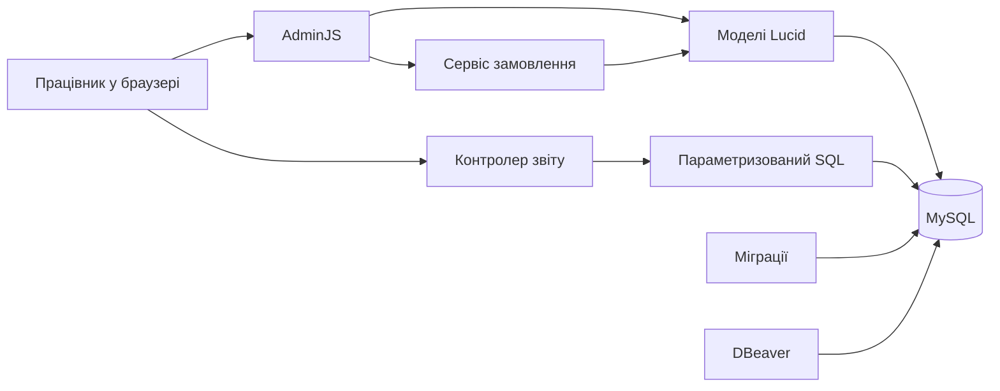
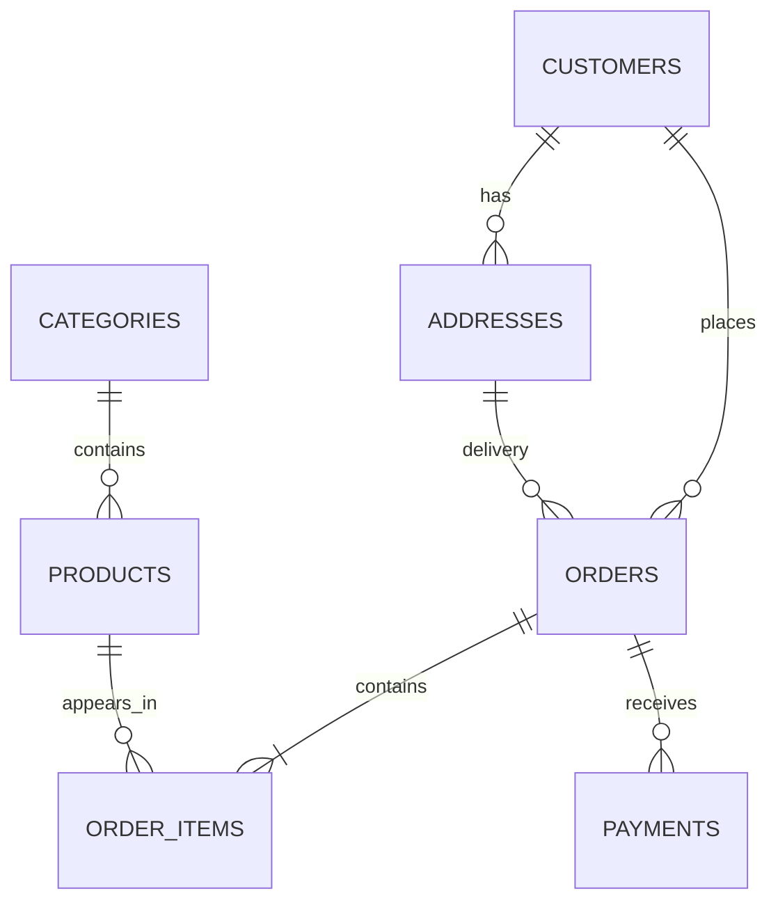

# Курсовий проєкт: інтернет-магазин на AdonisJS, AdminJS та MySQL

Покрокова інструкція для створення внутрішньої панелі працівника магазину. Ми самостійно проєктуємо сім таблиць, описуємо їх міграцією та моделями Lucid, підключаємо готовий CRUD AdminJS і додаємо контролер SQL-звіту.

Готовий код цього прикладу розміщений у [`app`](app/), а короткі команди запуску — в [`app/README.md`](app/README.md). Для самостійного проходження кроків нижче створюйте окремий каталог `store_nodejs`, щоб не перезаписати готовий застосунок.

Посібник проводить через повний цикл курсового проєкту: аналіз предметної області, проєктування реляційної схеми, реалізацію, перевірку та підготовку до захисту. Наскрізний приклад — інтернет-магазин із [практикуму з баз даних](../README.md).

Посібник доповнює [методичні вказівки до курсового проєкту](cp_book.pdf), насамперед розділ 2.6 і додаток Б. Кількість таблиць, запитів і сторінок сама по собі не є критерієм цього практикуму: обсяг визначається предметною областю. Важливо обґрунтувати структуру, реалізувати потрібні операції та перевірити результат. Правила оформлення пояснювальної записки узгодьте з керівником; цей Markdown-файл є практичною інструкцією, а не шаблоном записки. Вітрина покупця, банківський еквайринг і доставка не входять до базового прикладу.

## 1. Як застосунок працює з базою даних

**Фреймворк** — основа для побудови застосунку: він задає структуру проєкту й надає готові механізми для типових завдань. Наприклад, вебфреймворк приймає HTTP-запити браузера, зіставляє адреси з обробниками, допомагає працювати із сесіями та повертати відповіді. Розробник додає правила своєї предметної області — у нашому випадку роботу з товарами, клієнтами та замовленнями.

Для цього проєкту ми обрали **AdonisJS** — вебфреймворк для Node.js із підтримкою TypeScript. Node.js виконує серверний JavaScript-код, а AdonisJS організовує застосунок: маршрути, контролери, конфігурацію та інші компоненти. Це дає спільну структуру для всіх прикладів курсового проєкту.

Для роботи з базою даних підключаємо **Lucid** — ORM з екосистеми AdonisJS. Фреймворк керує обробкою запиту, а ORM відповідає за взаємодію коду з таблицями. Це пов’язані, але окремі інструменти: AdonisJS не зберігає записи самостійно, а Lucid передає запити до MySQL.

**ORM (Object–Relational Mapping)** — об’єктно-реляційне відображення та інструмент, який його реалізує. У цьому проєкті це Lucid: він перетворює операції з моделями на SQL і результати запитів — на об’єкти. Наприклад, `await Product.find(1)` шукає товар за первинним ключем і повертає екземпляр `Product` або `null`. ORM скорочує повторюваний код для читання, створення, зміни та видалення записів, але запити все одно виконує MySQL. Знання SQL потрібне для перевірки результатів, складних звітів і аналізу продуктивності.

**MySQL** — система керування базами даних: вона зберігає таблиці, виконує SQL, перевіряє обмеження та забезпечує транзакції. Для навчальних запитів і перевірки структури ми також підключаємося до неї напряму через DBeaver. SQL-звіт у застосунку виконує власний параметризований запит через інструменти Lucid.

**AdminJS** додає готовий вебінтерфейс працівника: списки, форми та дії над записами. Пакет `@adminjs/adonis` підключає цю панель до AdonisJS і моделей Lucid. Наприклад, коли працівник додає товар, форма AdminJS передає дані серверному застосунку, Lucid формує SQL-вставлення, а MySQL перевіряє обмеження та зберігає запис. Для складнішої операції, як-от створення замовлення з позиціями, ми додаємо власний сервіс.



| Компонент | Для чого потрібен |
|---|---|
| AdonisJS 6 | HTTP-сервер, маршрути, контролери, конфігурація й CLI `node ace` |
| Lucid 21 | ORM, зв’язки, міграції, SQL query builder і транзакції |
| AdminJS 7 | Готові форми та списки для моделей |
| `@adminjs/adonis` 1.1.1 | Інтеграція AdminJS, Lucid і сесій AdonisJS |
| MySQL 8.4 LTS | Зберігання даних, FK, UNIQUE, CHECK, SQL-запити |
| TypeScript | Мова моделей, контролерів і конфігурації |

### Послідовність роботи та матеріали до звіту

| Етап | Що робимо | Що додаємо до пояснювальної записки |
|---|---|---|
| Аналіз | Описуємо користувачів, сценарії, бізнес-правила й аналоги | Постановку задачі, аналіз аналогів і межі системи |
| Проєктування | Визначаємо сутності, ключі, зв’язки та функціональні залежності | ER-діаграму, словник даних, обґрунтування нормалізації |
| Реалізація | Створюємо міграції, моделі та сервіс замовлення | Фрагменти DDL, пояснення обмежень і транзакції |
| Інтерфейс | Налаштовуємо AdminJS та сторінку звіту | Сценарії користувача, скріншоти форм і звіту |
| Перевірка | Виконуємо коректні й помилкові операції через UI та SQL | Очікувані й фактичні результати із зазначенням рівня перевірки |
| Відтворення | Розгортаємо застосунок із порожньої БД | Інструкцію запуску, версії залежностей і висновки |

## 2. Підготовка

Потрібні базові знання JavaScript/TypeScript: модулі, класи, об’єкти, масиви, `async/await` та винятки. Для сторінки звіту достатньо HTML. Власний React-застосунок для базового CRUD не потрібен: інтерфейс надає AdminJS.

Потрібні інструменти:

1. Node.js 22 LTS з актуальним патчем цієї гілки та npm.
2. MySQL 8.4 LTS із запущеним сервером.
3. DBeaver або клієнт `mysql`.
4. Редактор із підтримкою TypeScript.

Перевірте:

```bash
node --version
npm --version
mysql --version
```

Очікуємо Node.js `v22.x` і MySQL `8.4.x`. Встановлення MySQL та DBeaver описане в [основному README](../README.md). Якщо команда `mysql` недоступна, SQL нижче можна виконувати в DBeaver.

## 3. Створення застосунку з відомого шаблону v6

**Пакет** — готовий модуль коду, який можна підключити до проєкту; **залежність** — пакет, потрібний нашому застосунку або інструментам розробки. `npm` встановлює пакети, а `npx` запускає утиліти з пакетів. `npm install` додає залежності; `--save-dev` позначає інструменти, потрібні для розробки, наприклад типи TypeScript.

У `package.json` записані залежності та команди проєкту (`scripts`), а `package-lock.json` фіксує точні версії встановленого дерева залежностей. `npm run dev` запускає команду `dev` із `scripts`; `npm ci` відтворює встановлення за lock-файлом. Каталог `node_modules` містить завантажені пакети й може бути відновлений цими командами.

**CLI** — інтерфейс командного рядка. `node ace` запускає CLI AdonisJS, через який створюємо файли й застосовуємо міграції. Команди виконуйте в терміналі; `cd` змінює поточний каталог. Шлях до файла в команді рахується від цього каталогу.

У номері версії на кшталт `6.21.0` перше число називають **major**. Перехід на інший major може вимагати змін у коді. Позначення `latest` означає актуальну версію пакета, яка не обов’язково сумісна з рештою нашого стека.

**Чому тут AdonisJS 6, а не `latest`:** перевірений `@adminjs/adonis` 1.1.1 декларує `@adonisjs/core ^6.2.2`, `@adonisjs/lucid ^21.0.1` і `@adonisjs/session ^7.1.1`. Не змішуйте ці приклади з генератором нового major AdonisJS. Гілки залежностей зафіксовані командами нижче, точні версії встановлених пакетів — у вашому `package-lock.json`. Номер major генератора `create-adonisjs` не дорівнює major фреймворку.

Джерела: [залежності інтеграції](https://github.com/SoftwareBrothers/adminjs-adonis/blob/main/package.json), [налаштування AdminJS для Adonis](https://docs.adminjs.co/installation/plugins/adonis). Перевірено 14 жовтня 2026 року.

Усі наступні файлові шляхи, крім першої команди, задані відносно каталогу нового застосунку `course_project/store_nodejs`.

З кореня цього репозиторію виконайте:

```bash
cd course_project
npx --yes degit@2.8.4 adonisjs/slim-starter-kit#cfd5d0d84e8d35abde77e5c16df2e8c15e245712 store_nodejs
cd store_nodejs
npm install @adonisjs/core@6 @adonisjs/lucid@21 @adonisjs/session@7 @adminjs/adonis@1.1.1 adminjs@7 mysql2@3 luxon@3
npm install --save-dev @types/luxon@3
```

`degit` копіює офіційний мінімальний starter kit із конкретного коміту без вкладеної історії Git. Це зберігає відтворювану структуру AdonisJS 6. Каталог `store_nodejs` має бути новим; не використовуйте примусове перезаписування свого застосунку.

**`.env`** — звичайний текстовий файл налаштувань конкретного середовища запуску. Назва походить від environment — «середовище». У ньому записують пари `НАЗВА=значення`, наприклад `PORT=3333`. AdonisJS завантажує ці значення під час запуску: так один і той самий код може працювати з різними базами й паролями на комп’ютерах студентів.

**`.env.example`** — шаблон із назвами змінних і безпечними прикладами, який зберігають у Git. Його копіюють у власний `.env` і підставляють локальні значення. Сам `.env` із паролями не додають до репозиторію. Правила виключення задає файл **`.gitignore`**; він не шифрує дані й не прибирає секрет, який уже потрапив до історії Git.

Зберігайте файл саме як `.env`, без розширення `.txt`, у корені застосунку поруч із `package.json`. Це файл для редагування, а не команда для термінала. Він не шифрується автоматично. Після зміни налаштувань перезапустіть dev-сервер, щоб застосунок точно використав нові значення.

Створіть `.env` копіюванням `.env.example` у редакторі. Або виконайте одну команду, однакову для PowerShell, macOS і Linux:

```bash
node -e "require('node:fs').copyFileSync('.env.example', '.env', require('node:fs').constants.COPYFILE_EXCL)"
node ace generate:key
```

`APP_KEY` — ключ шифрування сесій. Збережіть згенероване значення; не замінюйте його текстом із прикладу.

Це секрет застосунку, а не пароль для входу працівника чи MySQL. Зміна ключа може зробити наявні сесії непридатними; не генеруйте його заново при кожному запуску.

Налаштуйте пакети послідовно:

```bash
node ace configure @adonisjs/lucid --db=mysql
node ace configure @adonisjs/session
node ace configure @adminjs/adonis
```

**Драйвер БД** — пакет, який забезпечує з’єднання з конкретною СУБД; тут це `mysql2`. **Провайдер** підключає можливості пакета до життєвого циклу AdonisJS. **Middleware** — обробник у ланцюжку проходження HTTP-запиту: наприклад, він розбирає тіло запиту або завантажує сесію перед викликом контролера. Наведені команди конфігурації допомагають зареєструвати ці компоненти.

Якщо CLI пропонує встановити драйвер MySQL, погодьтеся. Пакети додають конфігурацію, провайдери, команди й middleware. Перевірте результат:

- `config/database.ts` — підключення до MySQL;
- `config/session.ts` — сесії;
- `config/adminjs.ts` — AdminJS;
- `app/admin/auth.ts`, `app/admin/component_loader.ts` — вхід і компоненти;
- `start/kernel.ts` — middleware сесії;
- `adonisrc.ts` — провайдери Lucid, Session і AdminJS.

Поки не запускайте панель: згенерований `app/admin/auth.ts` ще не перевіряє пароль. Ми замінимо його в розділі 9.

Перевірте дерево версій:

```bash
npm ls @adonisjs/core @adonisjs/lucid @adonisjs/session @adminjs/adonis adminjs
```

Мають бути major `6`, `21`, `7`, версія `1.1.1` і major `7` відповідно, без `invalid`. Не обходьте конфлікти через `--force` чи `--legacy-peer-deps`: перевірте, чи використано саме шаблон і команди з цього розділу.

## 4. База даних та змінні середовища

### 4.1. Створення окремої бази

У DBeaver під користувачем, який має права створювати бази й користувачів, виконайте:

```sql
CREATE DATABASE course_store_node
  CHARACTER SET utf8mb4 COLLATE utf8mb4_0900_ai_ci;

CREATE USER 'course_node'@'localhost'
  IDENTIFIED BY 'ReplaceThisLocalPassword!';

GRANT ALL PRIVILEGES ON course_store_node.*
  TO 'course_node'@'localhost';
```

Замініть пароль. Ці права потрібні також для навчальних міграцій. Не використовуйте `root` як обліковий запис застосунку.

Скрипти `../sql/01_create_database.sql` та `02_insert_data.sql` у цій базі **не запускаємо**: таблиці створює міграція. Якщо раніше створювали інші навчальні бази, не використовуйте їх замість `course_store_node`.

### 4.2. `.env`

У нашій конфігурації **host** — адреса сервера, а **port** — номер, за яким на цій адресі доступна певна служба. `127.0.0.1` означає цей самий комп’ютер. `HOST` і `PORT` налаштовують вебзастосунок (`3333`), а `DB_HOST` і `DB_PORT` — підключення до MySQL (`3306`). Це два різні серверні процеси.

`DB_DATABASE` — назва бази, `DB_USER` і `DB_PASSWORD` — облікові дані MySQL. Вони відрізняються від `ADMIN_EMAIL` та пароля працівника. `NODE_ENV=development` задає режим розробки, `LOG_LEVEL=info` — рівень повідомлень у журналі, `TZ=UTC` — часовий пояс процесу. `SESSION_DRIVER=cookie` обирає спосіб зберігання сесії; його розглянемо в розділі 9.

Залиште `APP_KEY`, згенерований раніше. Решту відповідних змінних налаштуйте так:

```dotenv
NODE_ENV=development
HOST=127.0.0.1
PORT=3333
LOG_LEVEL=info
TZ=UTC
DB_HOST=127.0.0.1
DB_PORT=3306
DB_USER=course_node
DB_PASSWORD=ReplaceThisLocalPassword!
DB_DATABASE=course_store_node
SESSION_DRIVER=cookie
ADMIN_EMAIL=admin@example.test
```

### 4.3. Створення хешу пароля

**Хешування пароля** обчислює значення для перевірки пароля без зберігання його відкритого тексту. Під час входу застосунок повторює обчислення для введеного пароля й порівнює результат зі збереженим. Це не шифрування з можливістю розшифрувати пароль. Тут використовуємо `scrypt`, призначений для такого обчислення.

**Сіль (salt)** — випадкове значення, додане до обчислення: однакові паролі з різними солями мають різні результати. Сіль можна зберігати поруч із хешем. Сам хеш також не слід публікувати: за ним можна намагатися підібрати пароль.

Створіть каталог `scripts` і файл `scripts/create_admin_hash.mjs`. Це звичайний Node.js-скрипт, він працює незалежно від валідації `start/env.ts`:

```js
import { readFileSync, writeFileSync } from 'node:fs'
import { randomBytes, scryptSync } from 'node:crypto'
import { createInterface } from 'node:readline/promises'

const prompt = createInterface({ input: process.stdin, output: process.stdout })
try {
  const password = await prompt.question('Новий пароль адміністратора (ввід видимий): ')
  if (password.length < 12) {
    throw new Error('Використайте пароль щонайменше з 12 символів')
  }
  const salt = randomBytes(16).toString('hex')
  const digest = scryptSync(password, salt, 64).toString('hex')
  const line = `ADMIN_PASSWORD_HASH=${salt}:${digest}`
  const current = readFileSync('.env', 'utf8')
  const next = /^ADMIN_PASSWORD_HASH=.*$/m.test(current)
    ? current.replace(/^ADMIN_PASSWORD_HASH=.*$/m, line)
    : `${current.trimEnd()}\n${line}\n`
  writeFileSync('.env', next)
  console.log('Хеш записано в .env')
} finally {
  prompt.close()
}
```

Виконайте з кореня застосунку:

```bash
node scripts/create_admin_hash.mjs
```

Запам’ятайте пароль. До `.env` потрапляє лише хеш із випадковою сіллю; сам пароль не є аргументом shell-команди. Далі зареєструємо ці змінні у схемі середовища.

### 4.4. Валідація середовища

**Валідація** — перевірка, що значення відповідає заданим вимогам. У `.env` значення записані текстом; схема `start/env.ts` перевіряє наявність потрібних змінних і приводить їх до очікуваних типів, наприклад номер порту — до числа. Помилку конфігурації краще виявити при старті, ніж під час першого запиту користувача. `env.get('DB_PORT')` далі читає перевірене значення.

До наявного об’єкта схеми в `start/env.ts` додайте відсутні поля. Якщо конфігуратор уже додав DB-поля та `SESSION_DRIVER`, не дублюйте їх:

```ts
DB_HOST: Env.schema.string({ format: 'host' }),
DB_PORT: Env.schema.number(),
DB_USER: Env.schema.string(),
DB_PASSWORD: Env.schema.string(),
DB_DATABASE: Env.schema.string(),
SESSION_DRIVER: Env.schema.enum(['cookie'] as const),
ADMIN_EMAIL: Env.schema.string(),
ADMIN_PASSWORD_HASH: Env.schema.string(),
```

### 4.5. `config/database.ts`

Замініть вміст:

```ts
import env from '#start/env'
import { defineConfig } from '@adonisjs/lucid'

export default defineConfig({
  connection: 'mysql',
  connections: {
    mysql: {
      client: 'mysql2',
      connection: {
        host: env.get('DB_HOST'),
        port: env.get('DB_PORT'),
        user: env.get('DB_USER'),
        password: env.get('DB_PASSWORD'),
        database: env.get('DB_DATABASE'),
      },
      migrations: {
        naturalSort: true,
        paths: ['database/migrations'],
      },
    },
  },
})
```

`mysql` — ім’я підключення. Саме його передаємо до `LucidResource` в AdminJS; це не назва БД.

У DBeaver перевірте:

```sql
SELECT VERSION(), DATABASE(), @@default_storage_engine, @@sql_mode;
```

Очікується рушій `InnoDB`: він потрібен для зовнішніх ключів і транзакцій. У `sql_mode` має бути строгий режим, наприклад `STRICT_TRANS_TABLES`: значення поза діапазоном не повинні непомітно перетворюватися на інші числа. Lucid підтримує MySQL через `mysql2`: [конфігурація БД](https://lucid.adonisjs.com/docs/configuration).

## 5. Схема предметної області

| Модель | Таблиця | Основні зв’язки |
|---|---|---|
| Category | categories | Категорія має багато товарів |
| Product | products | Належить категорії |
| Customer | customers | Має адреси й замовлення |
| Address | addresses | Належить клієнту |
| Order | orders | Належить клієнту, використовує його адресу |
| OrderItem | order_items | Поєднує замовлення й товар, зберігає ціну продажу |
| Payment | payments | Належить замовленню |



Нагадаємо позначення, які використаємо в схемі та міграції:

| Позначення | Значення та приклад |
|---|---|
| PK (Primary Key) | Первинний ключ однозначно визначає запис, наприклад `products.id` |
| FK (Foreign Key) | Зовнішній ключ посилається на ключ іншої таблиці, наприклад `products.category_id` |
| UNIQUE | Забороняє повторення значення або комбінації значень, наприклад SKU |
| NOT NULL | Вимагає наявності значення; саме по собі не забороняє порожній рядок |
| CHECK | Перевіряє умову для значень, наприклад `price > 0` |
| DEFAULT | Значення, яке БД підставляє, коли його не вказано при вставленні |
| RESTRICT / CASCADE | Забороняє видалення батьківського запису за наявності посилань / видаляє залежні записи разом із ним |

**Складений ключ або обмеження** охоплює кілька стовпців: `UNIQUE(order_id, product_id)` забороняє повторити саме пару, але дозволяє один товар у різних замовленнях. **DDL** — SQL-команди визначення структури, наприклад `CREATE TABLE` та `ALTER TABLE`. **SKU** — унікальний артикул товару в каталозі.

`DECIMAL(12,2)` зберігає десяткове число з максимум 12 цифрами загалом, із них 2 після крапки. `UNSIGNED` для цілого числа означає діапазон без від’ємних значень. **NULL** означає відсутнє значення; це не нуль і не порожній текст.

У кожній таблиці є простий PK `id`. Для `order_items` додатково створимо `UNIQUE(order_id, product_id)`. Гроші зберігаємо в `DECIMAL(12,2)`, а в TypeScript представляємо рядками, щоб не втрачати точність через двійкові дроби `number`.

Адміністратор панелі й `Customer` — різні ролі. У базовому прикладі один працівник входить із реквізитами з `.env`; покупці не мають доступу до адмінки.

### 5.1. Проєктування перед написанням коду

Опишіть сценарії працівника: вести каталог, додати клієнта та його адресу, створити замовлення, зареєструвати платіж і отримати звіт. Для власної теми визначте своїх користувачів та операції, а не просто перейменуйте таблиці магазину.

Перед реалізацією:

1. Визначте сутності, атрибути, обов’язковість і допустимі значення.
2. Випишіть кандидатні ключі: наприклад, SKU товару та email клієнта; обґрунтуйте вибір `id` як PK.
3. Позначте кардинальність та обов’язковість кожного зв’язку.
4. Поясніть, чому адреси й позиції замовлення є окремими таблицями.
5. Перевірте функціональні залежності й відповідність 1НФ, 2НФ та 3НФ. Зберігання історичної ціни в позиції має власний зміст: це ціна конкретного продажу, а не копія поточної ціни каталогу.
6. Складіть словник даних: таблиця, стовпець, тип і довжина, NULL/NOT NULL, значення за замовчуванням, ключі, обмеження та призначення.

Автоматичне створення таблиць не доводить нормалізованість схеми. Приклад переходу до 3НФ є в [темі 1 практикуму](../README.md#тема-1-концептуальна-структура-бази-даних).

### 5.2. Бізнес-правила та рівні перевірки

| Правило | Реалізація в цьому посібнику |
|---|---|
| Email клієнта та SKU товару унікальні | UNIQUE у MySQL |
| Назви категорії, товару, клієнта, SKU та email не порожні | NOT NULL і CHECK для непорожнього тексту |
| Ціна, сума платежу та кількість у позиції додатні | CHECK у БД; для позицій — також сервіс |
| Складський залишок невід’ємний | Цілочисельний UNSIGNED-стовпець і строгий режим MySQL |
| Пов’язані категорія, клієнт, адреса й товар існують | Зовнішні ключі |
| Адреса належить клієнту замовлення | Складений FK і перевірка сервісу |
| Товар не повторюється в одному замовленні | UNIQUE(order_id, product_id) та перевірка сервісу |
| Замовлення має хоча б одну позицію | Транзакційний сервіс; редагування й видалення позицій у панелі вимкнені |
| Ціна продажу не змінюється разом із каталогом | `order_items.unit_price`, скопійована сервісом |
| Статуси належать визначеному набору | CHECK у MySQL; список значень для платежу в AdminJS |
| Історичні посилання не зникають при видаленні | FK з RESTRICT; CASCADE для позицій при видаленні замовлення |
| Звіт доступний лише працівнику | Перевірка сесії в контролері |

Код форми, сервіс, ORM і БД — різні рівні перевірки. Прямий SQL обходить форми та сервіс. Виклик моделі також не виконує автоматично весь сценарій сервісу. HTML-перевірка email не є серверною гарантією; якщо формат email є обов’язковим бізнес-правилом вашого проєкту, додайте серверний валідатор для всіх шляхів запису.

`onDelete('RESTRICT')` та `onDelete('CASCADE')` в міграції Lucid створюють SQL-правила зовнішніх ключів. Перевірте їх через `SHOW CREATE TABLE`. Видалення замовлення з платежами блокується, тому що `payments.order_id` має RESTRICT.

Адреса в цій навчальній схемі залишається посиланням на редагований запис: зміна вулиці змінить адресу, яку показуватиме старе замовлення. Для незмінної історії потрібна копія адреси в замовленні або версіонування. Усі суми прикладу — у гривнях; мультивалютність не реалізована. `payments.created_at` означає час реєстрації запису, а не підтверджений банком час оплати. Для такого часу потрібне окреме поле та правило його заповнення. Час застосунку зберігаємо в UTC; відображення для користувача можна переводити в `Europe/Kyiv`.

### 5.3. Адаптація SQL-практикуму

Назви таблиць зберігаються, але первинний ключ кожної предметної моделі тут — `id`. Тому в запитах із [каталогу sql](../sql/) замініть, наприклад, `products.product_id` на `products.id`, а `orders.order_id` на `orders.id`. Зовнішні ключі залишають назви `product_id`, `order_id`, `customer_id`.

У `order_items` замість складеного PK використано простий `id` та складений UNIQUE; відобразіть це у фізичній моделі. Перед виконанням чужого скрипта перевіряйте `USE online_store`, назви стовпців і операції зміни даних. Для прикладів цього посібника активна база — `course_store_node`. Службові таблиці міграцій не є сутностями предметної області.

## 6. Створення міграції

**Міграція** — файл із версіонованими інструкціями зміни БД: створити таблицю, додати стовпець, зовнішній ключ або індекс. Метод `up()` описує застосування зміни, а `down()` — зворотну операцію, якщо вона можлива. Lucid обліковує застосовані міграції у службовій таблиці, тому наступний запуск виконує лише нові. Файли міграцій зберігають у Git, щоб інший розробник міг відтворити ту саму структуру. Відкат, який видаляє стовпець, не відновлює його втрачені дані: міграція не замінює резервну копію.

У нашому магазині початкова міграція створить сім таблиць, їхні стовпці та обмеження. Наприклад, для ціни товару вона визначить стовпець `price DECIMAL(12,2)`. Пізніше окремою міграцією можна додати опис товару. Початкові записи додає seeder; це окреме завдання від створення структури.

Виконайте:

```bash
node ace make:migration create_store_schema
```

CLI створить файл із часовим префіксом у `database/migrations`. Замініть **цей згенерований файл**, не створюючи другу копію, таким кодом:

```ts
import { BaseSchema } from '@adonisjs/lucid/schema'

export default class extends BaseSchema {
  async up() {
    this.schema.createTable('categories', (table) => {
      table.increments('id')
      table.string('name', 100).notNullable().unique()
      table.check("CHAR_LENGTH(TRIM(name)) > 0", [], 'category_name_nonempty')
    })

    this.schema.createTable('customers', (table) => {
      table.increments('id')
      table.string('full_name', 150).notNullable()
      table.string('email', 254).notNullable().unique()
      table.timestamp('created_at').notNullable().defaultTo(this.now())
      table.check("CHAR_LENGTH(TRIM(full_name)) > 0", [], 'customer_name_nonempty')
      table.check("CHAR_LENGTH(TRIM(email)) > 0", [], 'customer_email_nonempty')
    })

    this.schema.createTable('addresses', (table) => {
      table.increments('id')
      table.integer('customer_id').unsigned().notNullable()
        .references('id').inTable('customers').onDelete('RESTRICT')
      table.string('city', 100).notNullable()
      table.string('street', 200).notNullable()
      table.string('postal_code', 20).notNullable()
      // Ціль для складеного FK із orders.
      table.unique(['id', 'customer_id'], 'address_id_customer_unique')
    })

    this.schema.createTable('products', (table) => {
      table.increments('id')
      table.integer('category_id').unsigned().notNullable()
        .references('id').inTable('categories').onDelete('RESTRICT')
      table.string('sku', 40).notNullable().unique()
      table.string('name', 200).notNullable()
      table.decimal('price', 12, 2).notNullable()
      table.integer('stock_quantity').unsigned().notNullable().defaultTo(0)
      table.boolean('is_active').notNullable().defaultTo(true)
      table.check('price > 0', [], 'product_price_positive')
      table.check("CHAR_LENGTH(TRIM(sku)) > 0", [], 'product_sku_nonempty')
      table.check("CHAR_LENGTH(TRIM(name)) > 0", [], 'product_name_nonempty')
    })

    this.schema.createTable('orders', (table) => {
      table.increments('id')
      table.integer('customer_id').unsigned().notNullable()
        .references('id').inTable('customers').onDelete('RESTRICT')
      table.integer('shipping_address_id').unsigned().notNullable()
      table.string('status', 20).notNullable().defaultTo('new')
      table.timestamp('created_at').notNullable().defaultTo(this.now())
      table.foreign(['shipping_address_id', 'customer_id'], 'order_address_owner_fk')
        .references(['id', 'customer_id']).inTable('addresses')
        .onDelete('RESTRICT').onUpdate('RESTRICT')
      table.check("status IN ('new','paid','shipped','completed','cancelled')", [], 'order_status_valid')
    })

    this.schema.createTable('order_items', (table) => {
      table.increments('id')
      table.integer('order_id').unsigned().notNullable()
        .references('id').inTable('orders').onDelete('CASCADE')
      table.integer('product_id').unsigned().notNullable()
        .references('id').inTable('products').onDelete('RESTRICT')
      table.integer('quantity').unsigned().notNullable()
      table.decimal('unit_price', 12, 2).notNullable()
      table.unique(['order_id', 'product_id'], 'order_product_unique')
      table.check('quantity > 0', [], 'item_quantity_positive')
      table.check('unit_price > 0', [], 'item_price_positive')
    })

    this.schema.createTable('payments', (table) => {
      table.increments('id')
      table.integer('order_id').unsigned().notNullable()
        .references('id').inTable('orders').onDelete('RESTRICT')
      table.decimal('amount', 12, 2).notNullable()
      table.string('status', 20).notNullable().defaultTo('pending')
      table.timestamp('created_at').notNullable().defaultTo(this.now())
      table.check('amount > 0', [], 'payment_amount_positive')
      table.check("status IN ('pending','successful','failed','refunded')", [], 'payment_status_valid')
    })
  }

  async down() {
    this.schema.dropTable('payments')
    this.schema.dropTable('order_items')
    this.schema.dropTable('orders')
    this.schema.dropTable('products')
    this.schema.dropTable('addresses')
    this.schema.dropTable('customers')
    this.schema.dropTable('categories')
  }
}
```

Таблиці створюємо від незалежних до залежних, видаляємо у зворотному порядку. Складений FK гарантує, що адреса замовлення належить його клієнту, навіть при прямому SQL. Він також забороняє змінити власника вже використаної адреси.

Одна початкова міграція зручна для цього невеликого прикладу. Подальші зміни оформлюємо новими міграціями. Генератор `make:model Product --migration` також існує, але тут не використовуйте `--migration`: таблиці вже описані разом.

Застосуйте міграцію:

```bash
node ace migration:run
node ace migration:status
```

Виконуємо це **до реєстрації ресурсів AdminJS**, оскільки адаптер читає структуру таблиць при запуску вебзастосунку.

Перевірте в DBeaver:

```sql
USE course_store_node;
SHOW TABLES;
SHOW CREATE TABLE products;
SHOW CREATE TABLE orders;
SHOW CREATE TABLE order_items;
```

Очікуємо сім предметних таблиць і службові таблиці обліку міграцій. Знайдіть `DECIMAL`, FK, складений `UNIQUE` та `CHECK`.

`node ace migration:rollback` запускає `down()` останнього пакета міграцій. Для цієї початкової міграції це видалення всіх семи таблиць із даними — використовуйте тільки на одноразовій навчальній базі. MySQL не забезпечує атомарного відкату набору DDL: після помилки перевірте, які таблиці вже створені. Див. [міграції Lucid](https://lucid.adonisjs.com/docs/migrations).

## 7. Моделі Lucid

**Модель** — клас, через який програма працює із сутністю предметної області. Наприклад, клас `Product` відповідає таблиці `products`, а його екземпляр — конкретному товару. Властивості `name` і `price` відповідають стовпцям; зв’язок `category` дозволяє отримати категорію товару. Модель описує, як дані представлені в коді. Саме оголошення класу не створює таблицю в MySQL.

На прикладі ціни товару: **міграція** створює стовпець `price DECIMAL(12,2)`, **модель** `Product` оголошує властивість `price`, а **ORM** читає та записує її значення через SQL. У вибраному підході Lucid зміна класу моделі сама по собі не змінює схему БД — для цього пишемо й застосовуємо нову міграцію.

Створіть файли:

```bash
node ace make:model Category
node ace make:model Customer
node ace make:model Address
node ace make:model Product
node ace make:model Order
node ace make:model OrderItem
node ace make:model Payment
```

Замініть згенеровані файли наведеними нижче. Для цього посібника назви властивостей моделі збігаються з SQL-стовпцями (`category_id`, `full_name`). Це свідоме спрощення інтеграції AdminJS. Для властивостей із підкресленням явно задаємо `serializeAs`, наприклад `@column({ serializeAs: 'category_id' })`: за замовчуванням Lucid серіалізував би їх у camelCase (`categoryId`). AdminJS потребує однакових ключів у моделі, відповіді API та конфігурації форм; без цього значення й посилання можуть не відображатися.

`@column()` означає збережений стовпець, `@belongsTo()` — зв’язок. TypeScript-типи не створюють обмежень MySQL: за них відповідає міграція.

Записи з `@` — **декоратори**, які додають метадані до класу чи його властивості. `declare price: string` повідомляє TypeScript про тип властивості, а `static table = 'products'` явно задає таблицю. `import type` імпортує лише опис типу. Скорочені шляхи на кшталт `#models/product` — **аліаси імпортів**, налаштовані в `package.json` starter kit.

**Серіалізація** перетворює модель на дані для передавання або збереження, наприклад звичайний об’єкт для JSON-відповіді. Тому назви властивостей моделі та полів форми потрібно узгодити.

### `app/models/category.ts`

```ts
import { BaseModel, column } from '@adonisjs/lucid/orm'

export default class Category extends BaseModel {
  static table = 'categories'

  @column({ isPrimary: true })
  declare id: number

  @column()
  declare name: string
}
```

### `app/models/customer.ts`

```ts
import { BaseModel, column } from '@adonisjs/lucid/orm'
import { DateTime } from 'luxon'

export default class Customer extends BaseModel {
  static table = 'customers'

  @column({ isPrimary: true })
  declare id: number

  @column({ serializeAs: 'full_name' })
  declare full_name: string

  @column()
  declare email: string

  @column.dateTime({ autoCreate: true, serializeAs: 'created_at' })
  declare created_at: DateTime
}
```

### `app/models/address.ts`

```ts
import { BaseModel, column, belongsTo } from '@adonisjs/lucid/orm'
import type { BelongsTo } from '@adonisjs/lucid/types/relations'
import Customer from '#models/customer'

export default class Address extends BaseModel {
  static table = 'addresses'

  @column({ isPrimary: true })
  declare id: number

  @column({ serializeAs: 'customer_id' })
  declare customer_id: number

  @column()
  declare city: string

  @column()
  declare street: string

  @column({ serializeAs: 'postal_code' })
  declare postal_code: string

  @belongsTo(() => Customer, { foreignKey: 'customer_id' })
  declare customer: BelongsTo<typeof Customer>
}
```

### `app/models/product.ts`

```ts
import { BaseModel, column, belongsTo } from '@adonisjs/lucid/orm'
import type { BelongsTo } from '@adonisjs/lucid/types/relations'
import Category from '#models/category'

export default class Product extends BaseModel {
  static table = 'products'

  @column({ isPrimary: true })
  declare id: number

  @column({ serializeAs: 'category_id' })
  declare category_id: number

  @column()
  declare sku: string

  @column()
  declare name: string

  @column()
  declare price: string

  @column({ serializeAs: 'stock_quantity' })
  declare stock_quantity: number

  @column({ serializeAs: 'is_active' })
  declare is_active: boolean

  @belongsTo(() => Category, { foreignKey: 'category_id' })
  declare category: BelongsTo<typeof Category>
}
```

### `app/models/order.ts`

```ts
import { BaseModel, column, belongsTo } from '@adonisjs/lucid/orm'
import type { BelongsTo } from '@adonisjs/lucid/types/relations'
import { DateTime } from 'luxon'
import Customer from '#models/customer'
import Address from '#models/address'

export default class Order extends BaseModel {
  static table = 'orders'

  @column({ isPrimary: true })
  declare id: number

  @column({ serializeAs: 'customer_id' })
  declare customer_id: number

  @column({ serializeAs: 'shipping_address_id' })
  declare shipping_address_id: number

  @column()
  declare status: 'new' | 'paid' | 'shipped' | 'completed' | 'cancelled'

  @column.dateTime({ autoCreate: true, serializeAs: 'created_at' })
  declare created_at: DateTime

  @belongsTo(() => Customer, { foreignKey: 'customer_id' })
  declare customer: BelongsTo<typeof Customer>

  @belongsTo(() => Address, { foreignKey: 'shipping_address_id' })
  declare shipping_address: BelongsTo<typeof Address>
}
```

### `app/models/order_item.ts`

```ts
import { BaseModel, column, belongsTo } from '@adonisjs/lucid/orm'
import type { BelongsTo } from '@adonisjs/lucid/types/relations'
import Order from '#models/order'
import Product from '#models/product'

export default class OrderItem extends BaseModel {
  static table = 'order_items'

  @column({ isPrimary: true })
  declare id: number

  @column({ serializeAs: 'order_id' })
  declare order_id: number

  @column({ serializeAs: 'product_id' })
  declare product_id: number

  @column()
  declare quantity: number

  @column({ serializeAs: 'unit_price' })
  declare unit_price: string

  @belongsTo(() => Order, { foreignKey: 'order_id' })
  declare order: BelongsTo<typeof Order>

  @belongsTo(() => Product, { foreignKey: 'product_id' })
  declare product: BelongsTo<typeof Product>
}
```

### `app/models/payment.ts`

```ts
import { BaseModel, column, belongsTo } from '@adonisjs/lucid/orm'
import type { BelongsTo } from '@adonisjs/lucid/types/relations'
import { DateTime } from 'luxon'
import Order from '#models/order'

export default class Payment extends BaseModel {
  static table = 'payments'

  @column({ isPrimary: true })
  declare id: number

  @column({ serializeAs: 'order_id' })
  declare order_id: number

  @column()
  declare amount: string

  @column()
  declare status: 'pending' | 'successful' | 'failed' | 'refunded'

  @column.dateTime({ autoCreate: true, serializeAs: 'created_at' })
  declare created_at: DateTime

  @belongsTo(() => Order, { foreignKey: 'order_id' })
  declare order: BelongsTo<typeof Order>
}
```

## 8. Навчальні дані

**Seeder** — клас із кодом наповнення БД визначеним набором даних. Він допомагає відтворити навчальні приклади на іншому комп’ютері. Таблиці вже створено міграцією; тепер додамо до них записи.

Створіть seeder:

```bash
node ace make:seeder Demo
```

Замініть `database/seeders/demo_seeder.ts`:

```ts
import { BaseSeeder } from '@adonisjs/lucid/seeders'
import Category from '#models/category'
import Customer from '#models/customer'
import Address from '#models/address'
import Product from '#models/product'

export default class extends BaseSeeder {
  async run() {
    const category = await Category.updateOrCreate(
      { name: 'Ноутбуки' }, { name: 'Ноутбуки' }
    )
    const customer = await Customer.updateOrCreate(
      { email: 'olena@example.test' }, { full_name: 'Олена Тестова' }
    )
    await Address.updateOrCreate(
      { customer_id: customer.id, city: 'Київ', street: 'Навчальна, 1' },
      { postal_code: '01001' }
    )
    await Product.updateOrCreate(
      { sku: 'LAPTOP-001' },
      {
        category_id: category.id,
        name: 'Навчальний ноутбук',
        price: '25000.00',
        stock_quantity: 10,
        is_active: true,
      }
    )
  }
}
```

Запустіть:

```bash
node ace db:seed --files=database/seeders/demo_seeder.ts
```

Повторний запуск не дублює ці записи, але повертає їхні навчальні значення, зокрема ціну й залишок. Виконуйте seeder лише у своїй навчальній базі. Не вважайте конкретні `id` гарантованими: дивіться їх у таблицях або адмінці.

Розширте набір даних так, щоб перевірити порожню категорію, товар без продажів, клієнта з кількома адресами, кілька позицій у замовленні та кілька платежів. Для останніх сценаріїв спочатку реалізуйте сервіс із розділу 11. Фіксуйте навчальні записи в seeder за стабільними унікальними значеннями, а не за випадковими `id`. Для повторного створення замовлень у seeder окремо продумайте захист від дублікатів: повторний виклик `createOrder` сам по собі створює нове замовлення.

Використовуйте лише вигадані персональні дані. Seeder відновлює записи, описані в його коді; довільні зміни через адмінку до нього автоматично не потрапляють. Для збереження власного набору перенесіть потрібні значення до seeder або зробіть експорт навчальної БД засобами DBeaver. Перевіряйте відновлення в окремій порожній базі, а не поверх даних, які потрібно зберегти.

## 9. Вхід адміністратора

**Сесія** зберігає стан входу працівника між HTTP-запитами. Після перевірки пароля застосунок записує в сесію дані адміністратора; наступні запити до панелі та звіту використовують цей стан для перевірки доступу.

**Cookie** — невелике значення, яке браузер зберігає та надсилає серверу з наступними запитами за правилами cookie. У вибраному cookie-сховищі дані сесії захищає AdonisJS із використанням `APP_KEY`; це не відкритий пароль працівника.

**Автентифікація** перевіряє, хто увійшов, а **авторизація** — які дії йому дозволені. Тут є один адміністратор; заборона редагування позицій замовлення через `isAccessible` є окремою перевіркою доступу до дії.

### 9.1. `app/admin/auth.ts`

Повністю замініть небезпечний демонстраційний провайдер, який повертає користувача без перевірки пароля:

```ts
import { scryptSync, timingSafeEqual } from 'node:crypto'
import { DefaultAuthProvider } from 'adminjs'
import env from '#start/env'
import componentLoader from './component_loader.js'

export default new DefaultAuthProvider({
  componentLoader,
  authenticate: async ({ email, password }) => {
    if (typeof email !== 'string' || typeof password !== 'string') return null
    if (password.length > 256) return null

    const [salt, stored] = env.get('ADMIN_PASSWORD_HASH').split(':')
    if (!/^[a-f0-9]{32}$/.test(salt ?? '') || !/^[a-f0-9]{128}$/.test(stored ?? '')) {
      throw new Error('Некоректний ADMIN_PASSWORD_HASH: запустіть скрипт генерації')
    }
    const actual = scryptSync(password, salt, 64)
    const expected = Buffer.from(stored, 'hex')
    const validPassword = timingSafeEqual(actual, expected)
    if (!validPassword || email !== env.get('ADMIN_EMAIL')) return null

    return { email, title: 'Адміністратор магазину' }
  },
})
```

Це простий локальний навчальний вхід з одним працівником. Для багатокористувацької системи потрібні окрема таблиця працівників, ролі й керування паролями. `Customer` для цього не використовуйте.

## 10. CRUD-адмінка

**Ресурс AdminJS** — модель із налаштуваннями списків, форм і доступних дій. На її основі AdminJS надає інтерфейс CRUD: створення (Create), читання (Read), оновлення (Update) та видалення (Delete) записів.

### 10.1. Реєстрація моделей

Замініть `config/adminjs.ts`:

```ts
import type { AdminJSProviderConfig } from '@adminjs/adonis'
import { LucidResource } from '@adminjs/adonis'
import componentLoader from '../app/admin/component_loader.js'
import authProvider from '../app/admin/auth.js'
import Category from '#models/category'
import Customer from '#models/customer'
import Address from '#models/address'
import Product from '#models/product'
import Order from '#models/order'
import OrderItem from '#models/order_item'
import Payment from '#models/payment'

const readOnlyActions = {
  new: { isAccessible: false },
  edit: { isAccessible: false },
  delete: { isAccessible: false },
  bulkDelete: { isAccessible: false },
}

const adminjsConfig: AdminJSProviderConfig = {
  adapter: { enabled: true },
  auth: { enabled: true, provider: authProvider, middlewares: [] },
  middlewares: [],
  adminjs: {
    rootPath: '/admin',
    loginPath: '/admin/login',
    logoutPath: '/admin/logout',
    componentLoader,
    branding: { companyName: 'Навчальний магазин' },
    resources: [
      {
        resource: new LucidResource(Category, 'mysql'),
        options: {
          navigation: 'Каталог',
          properties: { name: { isTitle: true } },
          editProperties: ['name'],
        },
      },
      {
        resource: new LucidResource(Product, 'mysql'),
        options: {
          navigation: 'Каталог',
          listProperties: ['id', 'sku', 'name', 'price', 'stock_quantity', 'is_active'],
          editProperties: ['category_id', 'sku', 'name', 'price', 'stock_quantity', 'is_active'],
          properties: {
            name: { isTitle: true },
            category_id: { reference: 'categories' },
            price: { type: 'string', description: 'Додатна сума, наприклад 25000.00' },
            stock_quantity: { type: 'number', props: { min: 0, step: 1 } },
            is_active: { type: 'boolean' },
          },
        },
      },
      {
        resource: new LucidResource(Customer, 'mysql'),
        options: {
          navigation: 'Клієнти',
          editProperties: ['full_name', 'email'],
          properties: {
            full_name: { isTitle: true },
            email: { type: 'string', props: { type: 'email' } },
          },
        },
      },
      {
        resource: new LucidResource(Address, 'mysql'),
        options: {
          navigation: 'Клієнти',
          editProperties: ['customer_id', 'city', 'street', 'postal_code'],
          properties: {
            street: { isTitle: true },
            customer_id: { reference: 'customers' },
          },
        },
      },
      {
        resource: new LucidResource(Order, 'mysql'),
        options: {
          navigation: 'Продажі',
          actions: readOnlyActions,
          properties: {
            customer_id: { reference: 'customers' },
            shipping_address_id: { reference: 'addresses' },
          },
        },
      },
      {
        resource: new LucidResource(OrderItem, 'mysql'),
        options: {
          navigation: 'Продажі',
          actions: readOnlyActions,
          properties: {
            order_id: { reference: 'orders' },
            product_id: { reference: 'products' },
            quantity: { type: 'number' },
            unit_price: { type: 'string' },
          },
        },
      },
      {
        resource: new LucidResource(Payment, 'mysql'),
        options: {
          navigation: 'Продажі',
          editProperties: ['order_id', 'amount', 'status'],
          properties: {
            order_id: { reference: 'orders' },
            amount: { type: 'string' },
            status: {
              availableValues: [
                { value: 'pending', label: 'Очікується' },
                { value: 'successful', label: 'Успішний' },
                { value: 'failed', label: 'Невдалий' },
                { value: 'refunded', label: 'Повернення' },
              ],
            },
          },
        },
      },
    ],
  },
}

export default adminjsConfig
```

Ідентифікатор ресурсу цього адаптера — назва таблиці, тому посилання мають вигляд `reference: 'categories'`, а не `'Category'`. Поля `id` і `created_at` не включаємо у форми редагування.

Для довідників окремі CRUD-контролери не потрібні: маршрути й операції створює AdminJS. `editProperties` керує формою, але не є універсальним правилом авторизації чи валідації для інших шляхів запису. `isAccessible: false` забороняє дію на сервері; простого приховування кнопки недостатньо.

### 10.2. Перший запуск

**Перевірка типів** (`typecheck`) знаходить неузгодженості TypeScript без запуску бізнес-сценаріїв. **Збірка** (`build`) готує JavaScript-файли для запуску. **Dev-сервер** (`dev`) запускає застосунок для розробки та стежить за змінами файлів. Поки сервер працює, цей термінал зайнятий: для наступних команд відкрийте інший термінал у тому самому каталозі. Зупинити сервер можна через `Ctrl+C`.

```bash
npm run typecheck
npm run dev
```

Відкрийте <http://127.0.0.1:3333/admin>. Введіть `ADMIN_EMAIL` і пароль, з якого створювали хеш. Перша збірка клієнтських компонентів може тривати довше наступних запусків.

Перевірте:

1. Неправильний пароль не дає доступу.
2. Після входу є сім ресурсів.
3. У «Каталог» можна створити категорію й товар та змінити його ціну.
4. У «Клієнти» можна створити покупця й адресу.
5. Повторний SKU та від’ємна ціна відхиляються БД.
6. Після виходу списки недоступні без повторного входу.

Не всі помилки MySQL мають зручні повідомлення у згенерованому CRUD. Обмеження БД забезпечують цілісність; для зручнішої роботи з формою можна додати `before`-hooks AdminJS з польовою валідацією. **Hook** — функція, яку система викликає на певному етапі операції; `before` виконується перед основною дією. Наприклад, HTML `type=email` покращує форму, але не гарантує перевірку email для прямого SQL.

Джерела: [інтеграція Adonis](https://docs.adminjs.co/installation/plugins/adonis), [налаштування ресурсів](https://docs.adminjs.co/basics/resource), [дії AdminJS](https://docs.adminjs.co/basics/action).

## 11. Замовлення та транзакція

**Транзакція** об’єднує кілька операцій із БД в одну логічну дію. Якщо всі кроки успішні, зміни фіксуються (**commit**); якщо виникає помилка, незавершені зміни скасовуються (**rollback**). **Атомарність** означає, що застосовуються всі зміни цієї операції або жодна. Так помилка запису позиції не залишить у БД порожнє замовлення.

`trx` у коді — об’єкт поточної транзакції; усі її запити мають використовувати це підключення. `forUpdate()` блокує вибрані рядки для конкурентних змін до завершення транзакції. Це допомагає узгодити одночасні операції, наприклад читання ціни та її зміну. **Deadlock** — взаємне очікування блокувань різними транзакціями; однаковий порядок доступу до товарів зменшує його ймовірність.

Звичайний CRUD дозволив би спочатку створити порожнє замовлення, а потім окремо додавати позиції. Натомість створимо сервіс, який приймає масив позицій і записує все атомарно. Форма базової адмінки додаватиме одну позицію; сервіс уже підтримує кілька різних товарів.

### 11.1. Сервіс `app/services/order_service.ts`

**Сервіс** містить бізнес-операцію, яку можна викликати з різних інтерфейсів. Наш сервіс перевірятиме дані та створюватиме замовлення з позиціями незалежно від того, яка форма його викликала.

Створіть каталог `app/services`, якщо він відсутній, і файл:

```ts
import db from '@adonisjs/lucid/services/db'
import Address from '#models/address'
import Product from '#models/product'
import Order from '#models/order'
import OrderItem from '#models/order_item'

export class OrderInputError extends Error {}

type Line = { productId: number; quantity: number }
type Input = { customerId: number; addressId: number; items: Line[] }

const positiveInteger = (value: number) =>
  Number.isSafeInteger(value) && value > 0 && value <= 4294967295

export async function createOrder(input: Input) {
  if (!positiveInteger(input.customerId) || !positiveInteger(input.addressId)) {
    throw new OrderInputError('Оберіть клієнта й адресу')
  }
  if (input.items.length === 0 || input.items.length > 100) {
    throw new OrderInputError('Замовлення повинно мати від 1 до 100 позицій')
  }
  const ids = input.items.map((item) => item.productId)
  if (new Set(ids).size !== ids.length) {
    throw new OrderInputError('Товар не може повторюватись у замовленні')
  }
  if (input.items.some((item) => !positiveInteger(item.productId) || !positiveInteger(item.quantity))) {
    throw new OrderInputError('Товар і кількість мають бути додатними цілими числами')
  }

  return db.transaction(async (trx) => {
    const address = await Address.query({ client: trx })
      .where('id', input.addressId)
      .where('customer_id', input.customerId)
      .forUpdate()
      .first()
    if (!address) throw new OrderInputError('Адреса не належить обраному клієнту')

    // Однаковий порядок блокування зменшує ризик deadlock між замовленнями.
    const products = await Product.query({ client: trx })
      .whereIn('id', [...ids].sort((a, b) => a - b))
      .orderBy('id')
      .forUpdate()

    if (products.length !== ids.length || products.some((product) => !product.is_active)) {
      throw new OrderInputError('Усі товари мають існувати й бути активними')
    }
    const byId = new Map(products.map((product) => [product.id, product]))

    const order = await Order.create({
      customer_id: input.customerId,
      shipping_address_id: input.addressId,
      status: 'new',
    }, { client: trx })

    for (const item of input.items) {
      await OrderItem.create({
        order_id: order.id,
        product_id: item.productId,
        quantity: item.quantity,
        unit_price: byId.get(item.productId)!.price,
      }, { client: trx })
    }
    return order
  })
}
```

Ціну беремо з БД, а не з форми. Якщо будь-який запис позиції завершиться помилкою, транзакція відкочує й замовлення. Усі запити явно використовують `trx`.

Приклад веде облік: він **не списує залишки**, не перевіряє доступну кількість і не змінює статус автоматично після платежу. Якщо додаєте резервування, перевірка залишку й його зменшення мають відбуватися в цій самій транзакції під блокуванням товару.

### 11.2. Дія створення в AdminJS

Створіть `app/admin/order_resource.ts`:

```ts
import { LucidResource } from '@adminjs/adonis'
import { ValidationError } from 'adminjs'
import type { ResourceWithOptions } from 'adminjs'
import Order from '#models/order'
import { createOrder, OrderInputError } from '#services/order_service'

const orderResource: ResourceWithOptions = {
  resource: new LucidResource(Order, 'mysql'),
  options: {
    navigation: 'Продажі',
    listProperties: ['id', 'customer_id', 'shipping_address_id', 'status', 'created_at'],
    showProperties: ['id', 'customer_id', 'shipping_address_id', 'status', 'created_at'],
    editProperties: ['customer_id', 'shipping_address_id', 'product_id', 'quantity'],
    properties: {
      customer_id: { reference: 'customers' },
      shipping_address_id: { reference: 'addresses' },
      product_id: {
        type: 'reference', reference: 'products', isRequired: true,
        description: 'Перший товар замовлення',
        isVisible: { edit: true, filter: false, list: false, show: false },
      },
      quantity: {
        type: 'number', isRequired: true, props: { min: 1, step: 1 },
        isVisible: { edit: true, filter: false, list: false, show: false },
      },
    },
    actions: {
      new: {
        handler: async (request, _response, context) => {
          const { resource, currentAdmin, h } = context
          if (request.method !== 'post') {
            return { record: resource.build({}).toJSON(currentAdmin) }
          }
          const payload = request.payload ?? {}
          try {
            const order = await createOrder({
              customerId: Number(payload.customer_id),
              addressId: Number(payload.shipping_address_id),
              items: [{
                productId: Number(payload.product_id),
                quantity: Number(payload.quantity),
              }],
            })
            const record = await resource.findOne(String(order.id))
            if (!record) throw new Error('Створене замовлення не знайдено')
            return {
              record: record.toJSON(currentAdmin),
              redirectUrl: h.recordActionUrl({
                resourceId: resource.id(), recordId: String(order.id), actionName: 'show',
              }),
              notice: { message: 'Замовлення та позицію створено', type: 'success' },
            }
          } catch (error) {
            if (error instanceof OrderInputError) {
              throw new ValidationError({ quantity: { message: error.message } })
            }
            throw error
          }
        },
      },
      edit: { isAccessible: false },
      delete: { isAccessible: false },
      bulkDelete: { isAccessible: false },
    },
  },
}

export default orderResource
```

`product_id` та `quantity` тут — віртуальні поля форми. Стовпців із такими назвами в `orders` немає. Власний handler передає їх сервісу, а не стандартному `resource.create()`.

У `config/adminjs.ts`:

1. Видаліть імпорт `Order`.
2. Додайте `import orderResource from '../app/admin/order_resource.js'`.
3. У масиві `resources` замініть **весь об’єкт ресурсу Order** на `orderResource,`.
4. Ресурс `OrderItem` залиште з `readOnlyActions`.

Перезапустіть сервер після зміни конфігурації. У ресурсі замовлень з’явиться кнопка створення. Виберіть клієнта, його адресу, товар і кількість. Після збереження знайдіть позицію в `order_items`.

Список адрес у базовій формі не фільтрується за клієнтом. Сервіс перевіряє належність і показує помилку; складений FK додатково гарантує правило в БД. Залежний список адрес можна реалізувати окремим React-компонентом після завершення базового прикладу.

### 11.3. Перше наповнення та контрольний розрахунок

Коли вже працює дія створення замовлення, введіть через форми:

1. Категорію «Аксесуари».
2. Активний товар `ACC-001`, «Бездротова миша», ціна `1299.00`, залишок `30`.
3. Активний товар `ACC-002`, «USB-C адаптер», ціна `899.00`, залишок `50`.
4. Клієнта «Анна Коваль», `anna@example.test`.
5. Адресу цього клієнта: Київ, вул. Навчальна, 10, індекс `01001`.
6. Замовлення Анни з цією адресою, товаром `ACC-001` і кількістю `2`.
7. Платіж до цього замовлення на `2598.00` зі статусом `successful`.

Ручний розрахунок: `1299.00 × 2 = 2598.00`. Після зміни ціни товару в каталозі ціна позиції має залишитися `1299.00`. Статус замовлення залишається `new`, оскільки автоматичне узгодження з платежами не реалізовано. Для окремого товару або категорії без посилань перевірте видалення; для товару цього замовлення видалення має бути заборонене.

Поріг звіту `0` має включати це замовлення, а `3000` — виключати саме його. Інші створені замовлення можуть залишитися у звіті. Для кожного власного запиту пояснюйте значення одного рядка результату й наводьте контрольний розрахунок.

## 12. ORM, власний контролер і SQL-звіт

### 12.1. Одна вибірка двома способами

**REPL** — інтерактивна консоль: вводимо вираз, виконуємо його й одразу бачимо результат у контексті застосунку. **Query builder** — інструмент складання SQL через виклики методів, наприклад `where` та `orderBy`. **Bindings** — значення параметрів, передані окремо від тексту SQL.

Відкрийте консоль застосунку:

```bash
node ace repl
```

Виконайте послідовно (це JavaScript у REPL, не вміст файла):

```js
const { default: Product } = await import('#models/product')
const query = Product.query().where('is_active', true).where('price', '>=', '1000.00').orderBy('name')
console.log(query.toSQL())
const products = await query.preload('category')
console.table(products.map((product) => ({ name: product.name, category: product.category.name, price: product.price })))
```

`preload('category')` завантажує категорії додатковим запитом для набору товарів, уникаючи окремого запиту на кожен товар. Це не автоматичний JOIN. `toSQL()` показує основний запит і його bindings, але не додатковий запит preload. Документація: [Model query builder Lucid](https://lucid.adonisjs.com/docs/model-query-builder).

У DBeaver виконайте еквівалентну за змістом вибірку:

```sql
SELECT p.name, c.name AS category_name, p.price
FROM products AS p
JOIN categories AS c ON c.id = p.category_id
WHERE p.is_active = TRUE AND p.price >= 1000.00
ORDER BY p.name;
```

Порівняйте назви, категорії, ціни та кількість рядків. Поясніть фільтрацію, сортування та різницю між JOIN і preload. Вийдіть із REPL командою `.exit`.

### 12.2. Контролер звіту

**Маршрут (route)** пов’язує HTTP-метод і адресу з обробником. Наприклад, `GET /reports/orders` запускає метод контролера для читання звіту. Параметри після `?` в URL, як-от `min_total=1000`, утворюють **query string**; це вхідні дані, які потрібно перевіряти.

**Endpoint** — адреса певної операції API разом із її HTTP-методом. **API** — інтерфейс, через який програми звертаються до функцій застосунку. Наш endpoint може повертати HTML для браузера або **JSON** — текстовий формат структурованих даних. HTTP-статус `200` означає успіх, `400` — некоректний запит; перенаправлення повідомляє браузеру перейти на іншу адресу.


**Контролер** обробляє HTTP-запит і формує відповідь. Для звіту він перевірить сесію працівника, прочитає параметр мінімальної вартості, виконає SQL і поверне HTML або JSON. Стандартний CRUD уже обслуговує AdminJS; цей контролер реалізує окремий сценарій аналітики.

```bash
node ace make:controller reports
```

Створіть `app/services/order_report_view.ts`. Функція повертає просту HTML-сторінку з формою й таблицею; додаткові UI-пакети не потрібні.

```ts
export type OrderReportRow = {
  id: number
  full_name: string
  status: string
  total: string
}

function escapeHtml(value: unknown): string {
  return String(value).replace(/[&<>"']/g, (char) => ({
    '&': '&amp;', '<': '&lt;', '>': '&gt;', '"': '&quot;', "'": '&#39;',
  })[char]!)
}

export function renderOrderReport(minTotal: string, rows: OrderReportRow[], error = '') {
  const body = rows.length
    ? rows.map((row) => `<tr>
        <td>${escapeHtml(row.id)}</td>
        <td>${escapeHtml(row.full_name)}</td>
        <td>${escapeHtml(row.status)}</td>
        <td>${escapeHtml(row.total)}</td>
      </tr>`).join('')
    : '<tr><td colspan="4">За заданими умовами записів немає.</td></tr>'

  return `<!doctype html>
<html lang="uk">
<head>
  <meta charset="utf-8">
  <meta name="viewport" content="width=device-width, initial-scale=1">
  <title>Вартість замовлень</title>
  <style>
    body { font: 18px system-ui, sans-serif; max-width: 960px; margin: 32px auto; padding: 0 16px; }
    table { width: 100%; border-collapse: collapse; margin-top: 24px; }
    th, td { padding: 12px; border: 1px solid #ccc; text-align: left; }
    caption { text-align: left; margin-bottom: 12px; }
    input, button { font: inherit; padding: 8px; }
    .error { color: #a40000; }
    .table-wrap { overflow-x: auto; }
  </style>
</head>
<body>
  <a href="/admin">Керування магазином</a>
  <h1>Вартість замовлень</h1>
  <p>Сума позицій нескасованих замовлень у гривнях. Показано до 100 записів.</p>
  <form method="get" action="/reports/orders">
    <input type="hidden" name="format" value="html">
    <label for="min_total">Мінімальна вартість</label>
    <input id="min_total" name="min_total" type="number" min="0" max="9999999999.99"
      step="0.01" required value="${escapeHtml(minTotal)}">
    <button type="submit">Показати</button>
  </form>
  ${error ? `<p class="error" role="alert">${escapeHtml(error)}</p>` : ''}
  <div class="table-wrap">
    <table>
      <caption>Результат вибірки</caption>
      <thead><tr><th scope="col">Номер</th><th scope="col">Клієнт</th>
        <th scope="col">Статус</th><th scope="col">Вартість, грн</th></tr></thead>
      <tbody>${body}</tbody>
    </table>
  </div>
</body>
</html>`
}
```

Усі значення з БД та параметрів екрануються перед вставленням у HTML. Параметризація SQL захищає SQL-запит, але не замінює HTML-екранування. Грошову суму показуємо як точний DECIMAL-рядок із MySQL, без перетворення на `number`.

Замініть `app/controllers/reports_controller.ts`:

```ts
import type { HttpContext } from '@adonisjs/core/http'
import db from '@adonisjs/lucid/services/db'
import { renderOrderReport } from '#services/order_report_view'
import type { OrderReportRow } from '#services/order_report_view'

export default class ReportsController {
  async orders({ request, response, session }: HttpContext) {
    if (!session.get('adminUser')) return response.redirect('/admin/login')

    response.header('Cache-Control', 'no-store')
    const html = request.input('format') === 'html'
    const minTotal = String(request.input('min_total', '0'))
    if (!/^\d{1,10}(\.\d{1,2})?$/.test(minTotal)) {
      const error = 'min_total: невід’ємне число, до 2 знаків після крапки'
      if (html) return response.status(400).type('html').send(renderOrderReport(minTotal, [], error))
      return response.badRequest({ error })
    }

    const [rows] = await db.rawQuery(`
      SELECT o.id, c.full_name, o.status, o.created_at,
             SUM(oi.quantity * oi.unit_price) AS total
      FROM orders AS o
      JOIN customers AS c ON c.id = o.customer_id
      JOIN order_items AS oi ON oi.order_id = o.id
      WHERE o.status <> 'cancelled'
      GROUP BY o.id, c.full_name, o.status, o.created_at
      HAVING SUM(oi.quantity * oi.unit_price) >= CAST(? AS DECIMAL(12,2))
      ORDER BY total DESC, o.id DESC
      LIMIT 100
    `, [minTotal])

    if (html) {
      return response.type('html').send(renderOrderReport(minTotal, rows as OrderReportRow[]))
    }
    return { min_total: minTotal, limit: 100, orders: rows }
  }
}
```

Додайте до `start/routes.ts`, зберігши імпорт `router`:

```ts
const ReportsController = () => import('#controllers/reports_controller')
router.get('/reports/orders', [ReportsController, 'orders'])
```

Після входу в AdminJS у тому самому браузері відкрийте:

<http://127.0.0.1:3333/reports/orders?format=html&min_total=1000>

Результат — HTML-сторінка з полем мінімальної вартості та таблицею перших 100 замовлень. Для JSON-відповіді відкрийте той самий маршрут без `format=html`: <http://127.0.0.1:3333/reports/orders?min_total=1000>. Обидва представлення використовують один SQL-запит і ту саму перевірку сесії.

### 12.3. Перехід до звіту з адмінки

AdminJS має власну клієнтську маршрутизацію. Для переходу на окрему HTML-сторінку потрібна повна навігація браузера: звичайний `redirectUrl` дії може лише змінити адресу всередині панелі. Додамо невеликий React-компонент переходу; окремий frontend-застосунок не потрібен.

Встановіть пряму залежність компонента:

```bash
npm install --save-exact react@18.3.1
```

Створіть `app/admin/components/order_report.jsx`:

```jsx
/* global window */
import { createElement, useEffect } from 'react'

export default function OrderReport() {
  useEffect(() => {
    window.location.assign('/reports/orders?format=html')
  }, [])

  return createElement('a', { href: '/reports/orders?format=html' }, 'Відкрити звіт')
}
```

Замініть `app/admin/component_loader.ts`:

```ts
import { ComponentLoader } from 'adminjs'

const componentLoader = new ComponentLoader()
export const Components = {
  OrderReport: componentLoader.add('OrderReport', './components/order_report.jsx'),
}

export default componentLoader
```

У `adonisrc.ts` додайте до об’єкта `defineConfig` поле, щоб JSX-файл потрапляв до збірки:

```ts
metaFiles: [{ pattern: 'app/admin/components/**/*.jsx', reloadServer: false }],
```

У `app/admin/order_resource.ts` додайте імпорт `import { Components } from './component_loader.js'`, а до об’єкта `actions`, поруч із `new`, дію:

```ts
report: {
  actionType: 'resource',
  icon: 'BarChart',
  component: Components.OrderReport,
  handler: async () => ({}),
},
```

Після перезапуску в ресурсі замовлень з’явиться дія `report` для переходу до звіту. На сторінці звіту посилання «Керування магазином» повертає до AdminJS. Перевірте правильний і неправильний параметр, порожню вибірку та доступ після виходу з панелі.

Для своєї теми додайте звіти, які відповідають питанням користувача: товари без продажів, продажі за категоріями, активність клієнтів або заборгованість. Для кожного поясніть умови відбору й контрольний розрахунок.

`?` — параметр SQL, значення передається окремим масивом. Не вставляйте введений текст через `${...}` у SQL. Не приєднуйте `payments` до цього агрегування без попереднього підсумовування: кілька платежів можуть помножити рядки позицій. `total` — вартість товарів, а не отримана оплата.

Сесійний ключ `adminUser` використовується інтеграцією 1.1.1. При оновленні інтеграції перевірте цей контракт. Використовуйте однаковий hostname для панелі й звіту: cookies для `localhost` та `127.0.0.1` відрізняються.

Для власного CRUD-контролера існує команда:

```bash
node ace make:controller products --resource
```

Вона генерує каркас методів, а не повну бізнес-логіку. Для цього посібника виконувати її не потрібно: товари вже обслуговує AdminJS. При додаванні власного API потрібно окремо реалізувати валідацію, авторизацію та маршрути.

Джерела: [команди AdonisJS](https://docs.adonisjs.com/reference/commands), [SQL-запити Lucid](https://lucid.adonisjs.com/docs/raw-query-builder), [HTTP-відповідь AdonisJS](https://docs.adonisjs.com/guides/basics/response).

## 13. Зміна схеми після першого запуску

Приклад: додамо необов’язковий опис товару.

```bash
node ace make:migration add_description_to_products
```

У новому файлі міграції:

```ts
import { BaseSchema } from '@adonisjs/lucid/schema'

export default class extends BaseSchema {
  async up() {
    this.schema.alterTable('products', (table) => {
      table.text('description').nullable()
    })
  }

  async down() {
    this.schema.alterTable('products', (table) => {
      table.dropColumn('description')
    })
  }
}
```

Зупиніть dev-сервер і застосуйте:

```bash
node ace migration:run
```

Додайте до класу Product:

```ts
@column()
declare description: string | null
```

У ресурсі Product в `config/adminjs.ts` додайте `'description'` до `editProperties` та `description: { type: 'textarea' }` до `properties`. Запустіть сервер заново: адаптер читає метадані таблиць при старті.

Lucid у цьому підході не генерує diff міграції автоматично зі зміни класу моделі. Ви явно змінюєте міграцію, модель і налаштування форми. Не редагуйте вже застосований початковий файл, щоб додати новий стовпець.

## 14. Перевірка результату

Приклади цього посібника перевірені в окремому тимчасовому застосунку: Node.js 22.6.0, AdonisJS 6.21.0, Lucid 21.8.2, Session 7.7.1, `@adminjs/adonis` 1.1.1, AdminJS 7.8.17. Пройшли TypeScript-перевірка, збірка, початкова міграція, повторний seeder, HTTP-перевірки входу/виходу, CRUD товарів, створення замовлення, SQL-звіту й відхилення некоректної кількості. Примусова помилка вставлення позиції підтвердила rollback замовлення; перевірено відхилення порушень CHECK і FK.

Тестова СУБД — **MySQL 8.0.41**. Цільова версія курсу — **MySQL 8.4 LTS**; запуск саме на 8.4 та візуальна перевірка всіх форм у браузері залишаються частиною перевірки на комп’ютері студента. HTTP-перевірки не замінюють перевірку інтерфейсу. Додатково перевірені компіляція HTML-звіту, його HTTP-відповіді з даними й без даних, обробка та екранування некоректного параметра, дія переходу з AdminJS, ORM-приклад у REPL і застосування індексу з EXPLAIN.

### 14.1. Компіляція та структура

```bash
npm run typecheck
npm run build
node ace migration:status
```

Успішна компіляція не доводить правильність операцій із даними. Перевірте сценарії нижче на окремій навчальній базі.

### 14.2. Сценарії

| Дія | Очікуваний результат |
|---|---|
| Вхід із неправильним паролем | Відмова у вході |
| Відкриття `/reports/orders` без сесії | Перенаправлення на вхід |
| Створення товару з чинною категорією | Успішне збереження |
| Повторний SKU чи email | Відмова через UNIQUE |
| Ціна товару `0` або `-1` | Відмова через CHECK |
| Видалення категорії з товарами | Відмова через FK RESTRICT |
| Замовлення з кількістю `0`, `1.5` чи відсутнім товаром | Відмова; замовлення не створюється |
| Замовлення з адресою іншого клієнта | Відмова; немає частково записаного замовлення |
| Зміна власника адреси, використаної в замовленні | Відмова через складений FK |
| Створення правильного замовлення | Один рядок orders і одна або більше позицій |
| Зміна поточної ціни товару | Ціна наявної позиції замовлення не змінюється |
| Спроба редагувати/видалити позицію через API AdminJS | Дія недоступна |
| Повторний запуск seeder | Демо-каталог і клієнт не дублюються |
| Звіт із `min_total=abc` | HTTP 400; у HTML-режимі — повідомлення форми |
| Ім’я клієнта містить HTML-теги | У звіті це текст, а не виконувана розмітка |

Щоб перевірити саме rollback після початку запису, у **тимчасовій локальній копії** сервісу додайте `throw new Error('rollback check')` одразу після `Order.create`, спробуйте створити замовлення й порівняйте кількість рядків до та після. Вона не повинна змінитися. Відразу приберіть цей рядок. Пропуск значення AUTO_INCREMENT після rollback є нормальним.

### 14.3. Перевірка через SQL

```sql
-- Очікуємо порожній результат після створення замовлень через сервіс.
SELECT o.id
FROM orders o
LEFT JOIN order_items oi ON oi.order_id = o.id
GROUP BY o.id
HAVING COUNT(oi.id) = 0;

-- Очікуємо порожній результат; додатково це гарантує FK.
SELECT o.id
FROM orders o
JOIN addresses a ON a.id = o.shipping_address_id
WHERE a.customer_id <> o.customer_id;

-- Порівняйте ціну каталогу та історичну ціну після редагування товару.
SELECT oi.order_id, p.sku, p.price AS current_price, oi.unit_price
FROM order_items oi
JOIN products p ON p.id = oi.product_id;
```

Правило «замовлення має хоча б одну позицію» забезпечують сервіс і заборона довільного редагування через адмінку. Сам FK не забороняє прямий SQL `INSERT` порожнього замовлення чи видалення останньої позиції. Це межа гарантій, яку потрібно пояснити на захисті.

### 14.4. Індекс і план виконання

**Індекс** — додаткова структура БД для прискорення певних пошуків і сортувань. Він займає місце й потребує оновлення при зміні записів, тому індекси додають під конкретні запити. **План виконання** показує, як MySQL збирається отримати результат: які індекси використати, скільки рядків переглянути та як виконати сортування. Його переглядають командою `EXPLAIN`.

Оберіть часовий діапазон, який відповідає вашим даним, і виконайте в DBeaver:

```sql
SHOW INDEX FROM orders;
EXPLAIN SELECT id, customer_id, created_at
FROM orders
WHERE created_at >= '2026-10-01' AND created_at < '2026-11-01'
ORDER BY created_at;
```

Збережіть план, створіть нову міграцію:

```bash
node ace make:migration add_orders_created_index
```

Замініть вміст згенерованого файла:

```ts
import { BaseSchema } from '@adonisjs/lucid/schema'

export default class extends BaseSchema {
  async up() {
    this.schema.alterTable('orders', (table) => {
      table.index(['created_at'], 'orders_created_idx')
    })
  }

  async down() {
    this.schema.alterTable('orders', (table) => {
      table.dropIndex(['created_at'], 'orders_created_idx')
    })
  }
}
```

Застосуйте `node ace migration:run` і повторіть той самий `EXPLAIN`. Порівняйте `possible_keys`, `key`, `type`, оцінку `rows` та `Extra`. За потреби для цього SELECT використайте `EXPLAIN ANALYZE`: він справді виконує запит і показує фактичні вимірювання.

На маленькій таблиці оптимізатор може обрати повне сканування навіть після створення індексу. Зафіксуйте кількість рядків, план і фактичний результат, не вигадуйте прискорення. Перед додаванням індексу перевіряйте наявні: MySQL уже може мати індекси для FK та UNIQUE.

### 14.5. Автоматизовані перевірки

Для автоматизації використайте тестовий runner Japa зі starter kit. Зосередьтеся на бізнес-правилах: повний відкат, чужа адреса, повторення товару, історична ціна й доступ до звіту. Сам запуск `npm test` без цих тестів не доводить коректності реалізації.

Створіть окрему тестову MySQL-базу та користувача з правами тільки на неї, налаштуйте тестове середовище й застосуйте міграції. Перед будь-яким очищенням даних перевіряйте фактичне ім’я підключеної БД. Не запускайте тести з очищенням таблиць на базі ручної демонстрації. Якщо перевіряєте поведінку MySQL, SQLite не є рівноцінною заміною.

## 15. Типові проблеми

| Симптом | Що перевірити |
|---|---|
| Конфлікт peer dependencies | AdonisJS 6, Lucid 21, Session 7; чи не взято новий starter через `latest` |
| `Missing environment variable` | Усі поля `start/env.ts` мають відповідні значення `.env`; хеш уже згенеровано |
| `Access denied for user` | DB_USER, пароль, host і права саме на `course_store_node` |
| `ECONNREFUSED` | MySQL запущений, правильні host і port |
| `Table ... doesn't exist` при запуску AdminJS | Міграція застосована до тієї самої БД; не реєструйте ресурси раніше таблиць |
| `Unexpected type: int unsigned fallback to string` | Адаптер може не розпізнати unsigned-тип; для кількості явно задано `type: number`, для FK — `reference`. Перевірте форму й не змінюйте через це тип стовпця в БД |
| Ресурси порожні чи немає частини полів | Модель імпортована, поля мають `@column`, адаптер увімкнений; перезапустіть сервер |
| Немає списку вибору FK | `reference` дорівнює назві таблиці зареєстрованого ресурсу |
| Вхід працює з будь-яким паролем | Залишився стандартний `app/admin/auth.ts`; замініть його розділом 9 |
| Після входу знову login | Session middleware, `SESSION_DRIVER=cookie`, APP_KEY, один hostname |
| CHECK/FK помилка у формі | Звірте значення з бізнес-правилами, потім прочитайте повідомлення сервера |
| Звіт повертає порожній список | Є замовлення з позиціями; зменште `min_total` до `0` |

Цей посібник використовує slim starter без Shield. Якщо переносите код у web starter із CSRF-middleware, його інтеграцію з AdminJS потрібно перевірити окремо; не вимикайте захист у всьому застосунку заради усунення помилки 403.

## 16. Що здати та як відтворити

Структура основних файлів після виконання:

```text
store_nodejs/
  app/
    admin/
      auth.ts
      component_loader.ts
      components/order_report.jsx
      order_resource.ts
    controllers/reports_controller.ts
    models/
      category.ts
      customer.ts
      address.ts
      product.ts
      order.ts
      order_item.ts
      payment.ts
    services/
      order_service.ts
      order_report_view.ts
  config/
    adminjs.ts
    database.ts
    session.ts
  database/
    migrations/
    seeders/demo_seeder.ts
  scripts/create_admin_hash.mjs
  start/
    env.ts
    kernel.ts
    routes.ts
  .env.example
  adonisrc.ts
  package.json
  package-lock.json
```

Додайте до `.env.example` назви потрібних змінних, але залиште паролі, `APP_KEY` і `ADMIN_PASSWORD_HASH` порожніми. `.env`, `node_modules`, `build` та згенеровані файли `.adminjs` не включайте до Git. Перевірте `.gitignore`.

У пояснювальній записці послідовно опишіть предметну область та аналоги, постановку задачі, вибір AdonisJS/AdminJS і MySQL, ER-модель та нормалізацію, словник даних, реалізацію обмежень, запити, інтерфейс, результати перевірок і висновки.

Покажіть відповідність «бізнес-правило → реалізація → перевірка». Додайте суттєві фрагменти DDL, міграції, скріншоти CRUD і HTML-звіту, транзакцію та план виконання обраного запиту. Скріншот таблиці не замінює SQL або пояснення схеми. Окремо поясніть, що згенерував AdminJS і яку бізнес-логіку ви реалізували самостійно.

Відтворення на іншому комп’ютері:

1. Встановити Node.js і MySQL, скопіювати вихідні файли з lock-файлом.
2. Виконати `npm ci` у каталозі застосунку.
3. Створити порожню БД і користувача за розділом 4.
4. Скопіювати `.env.example` у `.env`, заповнити DB-параметри й `ADMIN_EMAIL`.
5. Виконати `node scripts/create_admin_hash.mjs`.
6. Якщо валідація вимагає непорожній APP_KEY до `generate:key`, створити його незалежно від Ace командою `node -e "console.log(require('node:crypto').randomBytes(32).toString('base64'))"` і записати результат у `.env`. Потім за потреби виконати `node ace generate:key`.
7. Виконати `node ace migration:run`, потім `node ace db:seed --files=database/seeders/demo_seeder.ts`.
8. Виконати `npm run typecheck`, `npm run build` та `npm run dev`.
9. Увійти, створити замовлення й відкрити звіт.

Це інструкція для локальної курсової роботи з `HOST=127.0.0.1`. Перед публікацією в інтернеті окремо потрібні перевірка залежностей, HTTPS, захист запитів, обмеження спроб входу, керування ролями та резервне копіювання. Під час контрольного встановлення `npm audit` повідомив про вразливості в дереві залежностей. Перед розгортанням потрібно розібрати звіт і перевірити доступні виправлення; автоматичне `npm audit fix --force` може зламати цю комбінацію major-версій.

### Підготовка до захисту

Перевірте, що інша людина може виконати інструкцію відтворення без вашої допомоги. На захисті варто вміти пояснити:

- як модель відповідає таблиці, а міграція змінює її структуру;
- чому схема відповідає обраній нормальній формі;
- де перевіряється кожне правило та що станеться при прямому SQL;
- чим поточна ціна відрізняється від ціни продажу;
- як транзакція запобігає частково створеному замовленню;
- які SQL-запити виконує ORM і як перевірити результат вручну;
- як працюють фільтр звіту, параметризація та перевірка доступу;
- що змінилося в плані запиту після додавання індексу;
- які спрощення залишилися в навчальній системі.

Подальші розширення обирайте за змістом теми: форма з кількома позиціями, резервування та скасування замовлення, керовані переходи статусів, незмінна історія адрес, ролі працівників, звіт про заборгованість, експорт CSV або SQL-представлення. Кожне розширення має розв’язувати конкретну задачу й мати спосіб перевірки. Кількість функцій сама по собі не замінює обґрунтованого проєктування.
